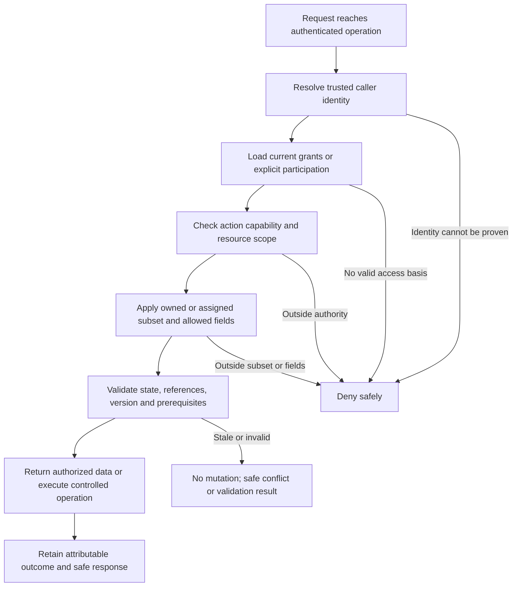

# Access matrix and authorization contract

Status: proposed technical contract implementing confirmed permissions through D071. Business permissions come from [PERMISSION-MATRIX.md](../requirements/PERMISSION-MATRIX.md); this document specifies how to evaluate them without adding roles or privileges. Storage/backend binding, caller identity proof and historical/offboarding detail remain open implementation/design details. D072 directs architecture/resource design to continue; the owner handles tenant access/connectors when implementing each feature. No permission changes or runtime checks have been performed.

## Identity, role and participation

Propose one principal per authenticated company directory identity, keyed by tenant ID plus immutable object ID. Email is retained for display/contact and migration matching, not trusted as caller proof or a permanent key. Company identity/guest support must be verified before finalizing this binding; no guest policy is inferred. The Custodian-only pending-directory placeholder is never an authenticating principal, owner or approver.

An Access Grant links one principal, one role and one scope. Multiple explicit grants combine their valid business capabilities, while every action still satisfies its own resource/state/field/approval checks. No role acquires a capability merely because its name sounds senior. Unknown, malformed or inactive grants authorize nothing.

| Role in Access Grants | Scope kind | Organization / Function references | Additional resource restriction |
| --- | --- | --- | --- |
| Viewer | Pair | Both present; Function belongs to Organization | Explicit assigned records/subsets; assignment semantics and fields need final definition |
| Asset Operator | Pair | Both present and consistent | Authorized asset operations; no disposal through this role alone |
| Inventory Operator | Pair | Both present and consistent | Quantity-inventory operations, not asset operations |
| Asset Manager | Pair | Both present and consistent | Asset/stock/reconciliation/disposal capabilities in the pair |
| Business Owner | Pair | Both present and consistent | Relevant owned assets/results only; ownership alone does not authorize any arbitrary action |
| Global User | Entity | Organization present; Function empty | Assigned entity across functions; ordinary-role administration only |
| Super User | Application | Both empty | Application-wide maintenance; explicit workflow capacities still apply |

Pair-shaped Viewer/Business Owner grants are the proposed representation of existing scoped roles. They never expand assigned/owned subsets to the full pair. Multiple pairs require multiple grants; do not invent wildcard Organization/Function records. Exact Viewer assignment semantics remain open before enabling that route.

Respondent is participation attached to an assignment, not an extra permanent Access Grant role. Accounting/Governance and Business Owner approval capacities come from explicit workflow assignments, not new permanent Accounting/Governance roles. A person may have operational roles plus independent assignments. A task-only principal can enter assigned work without general register access.

## Logical records and evidence

| Responsibility | Minimum contract | Source of authority |
| --- | --- | --- |
| Principal | Stable authenticated identity key and current directory binding; display contact separate | Proven company authentication mapping |
| Access Grant | Principal, role, scope shape, active/revoked state and attributable changes | Authorized Global/Super administration and controlled initial bootstrap |
| Record assignment | Principal, resource/process ID, exact row subset/snapshot and permitted participation/current-history visibility | Authorized assignment workflow; Viewer policy still open |
| Approval assignment | Workflow/attempt/snapshot version, named responder, required capacity and scope | Configured workflow routing; actual service responder identity validated |
| Authorization/operation evidence | Authenticated actor, action, resource/scope/version, result and correlation; safe denial details | Server evaluation and durable operation outcomes |

Proposed fields for the first two responsibilities are in [ACCESS-GRANT-COLUMNS-DRAFT.csv](../sharepoint/v2/ACCESS-GRANT-COLUMNS-DRAFT.csv). These are reviewable field contracts, not instructions to create lists. Assignment/approval/history lists follow their workflow contracts; do not replace them with a single unrestricted ProcessParticipants list.

## Evaluation order

The diagram is an enforcement proposal, not a new user-facing approval. A client-supplied email/object ID/role, selected organization, hidden button, request ID or source record reference is input to validate, never proof of identity or authority. Use the authoritative record's scope, not merely the submitted scope. Reject a mismatched Organization/Function pair rather than repairing it silently.

For reads, filtering, counts, search suggestions, errors, attachments, activity and export must use the same authorized row/field subset. Do not fetch a broad register into the client and then filter it there. Do not return full mixed-owner request metadata when only a restricted subset is visible. Denials must not reveal whether another entity's record exists.

For writes, action capability, authority, field requiredness and references are checked again at execution. D044 keeps business fields optional in SharePoint and validated in Power Apps; the controlled write path also rejects invalid submissions. Concurrency, retry and approval gates remain part of the operation contract. Approval is not permission to invoke any arbitrary mutation.

## Action rules carried into operations

| Operation | Required authority and boundary | Additional prerequisites |
| --- | --- | --- |
| Asset create/import | Asset Operator/Asset Manager within pair, or valid Global/Super maintenance capability | Create-only, unique Accounting Asset Code, generated tag, confirmed registration fields/state; initial finance contract |
| Asset BAU movement | Authorized asset-operation capability in source scope | No entity/function/owner change; valid values/version and per-asset history |
| Asset owner/scope transfer | Authorized submission/application path and source-scope authority | Required outgoing/receiving owner capacities; one explicit decision if same authorized person; approved snapshot/version; destination type/category consistency |
| Direct disposal | Asset Manager or applicable Global/Super maintenance capability in scope | Valid per-asset Sale/Non-sale inputs/eligibility and history; no disposal approval added |
| Inventory operation | Inventory Operator or applicable Global/Super maintenance capability in scope | Quantity/scope/concurrency/history rules; no asset-style dual-owner approval |
| Stock respondent save/submit | Exact current assignment to authenticated principal | Open editable response and permitted fields only; never master register |
| Stock review/reopen/reassign | Asset Manager or applicable scoped Global/Super authority | D021/D022 reason/audit for exceptional reopen/reassignment; ordinary BAU reason not added |
| Stock owner sign-off | Exact configured named workflow capacity | Relevant versioned owner subset; unresolved assets remain unverified |
| Reconciliation correction | Asset Manager or applicable scoped Global/Super authority | Eligible reviewed fields/current versions; action-specific prerequisites retained; apply before final sign-off under D070 |
| Reconciliation final sign-off | Exact configured Accounting/Governance assignment | Actual-result snapshot after application; unresolved-follow-up eligibility/rejection handling still open |
| Report/export | Existing role/module/owned/assigned read basis | Same or narrower fields/rows than read; protected output; defined historical scope |
| Standard respondent reminder | Business Owner over relevant owned work or Asset Manager in scope | Relevant pending respondent eligibility; no response/status change; broader Global/Super reminder matrix remains open |
| Grant ordinary roles | Global User within entity, or Super User | Target Pair within that entity; no Global escalation to privileged roles; attributable grant changes |
| Grant Global/Super roles | Super User only | Valid scope shape and bootstrap/recovery contract; application role is not company platform administrator |

The exact Global/Super capability expansion is defined per operation; the existing unresolved administrative/reminder matrix is not silently completed here. Super User is not an automatic workflow approver. Business Owner can request reopening but cannot reopen solely from that role. Viewer and Respondent cannot write master data from those permissions alone.

## Historical assignments, transfers and revocation

Preserve the original assigned snapshot and participation history. A former respondent can read the permitted historically assigned work but cannot edit replacement responses or use that record to fetch the current master. A new assignee gets explicit task access; reassigning does not erase the prior evidence. A transferred asset's identity remains stable, while current operational authority is re-evaluated against the destination; prior workflow participants do not receive permanent unrestricted access to its future record.

Removing an operational role and disabling a company identity are distinct events. Historical participation does not automatically expire when an operational grant changes, but it does not override directory/account restrictions. Exact historical fields, retention, offboarding and revocation/cache deadlines remain company/design gates. This is not approval to preserve access for a disabled employee. Until the policy is defined, affected revocation/history acceptance cases remain blocked rather than guessed.

Grant changes require an authorized administrative operation; ordinary users cannot edit authorization records directly. The first Super User and emergency recovery must use a controlled company-admin bootstrap with evidence, not a public self-registration or self-promotion route. Bootstrap identity/approval ownership is not yet known.

## Backend approach to evaluate

The leading candidate is a controlled read/write service boundary over protected SharePoint data, with no broad direct end-user master-data access. The boundary proves caller identity, evaluates this contract, queries only authorized data and returns a safe projection. Exact Power Automate/API mechanism, tenant permissions, connector/licensing fit, paging/performance and operational ownership are not established. See [platform findings and alternatives](BACKEND-ACCESS-FEASIBILITY.md).

An alternative uses native SharePoint permissions for direct reads plus controlled writes, but it must cover owned/assigned subsets, field projections, transfers, historical snapshots and growing permission scopes. It is not selected by default. App filtering with site-wide Read/Edit does not satisfy the accepted scope model.

Do not create operational authorization lists or enable privileged flows until the caller identity, protection and mutation paths are concrete. The role/record evaluation and field proposals can be reviewed now. [SOLUTION-AND-CONNECTOR-ARCHITECTURE.md](SOLUTION-AND-CONNECTOR-ARCHITECTURE.md) documents the connector/access dependencies for later owner configuration. The [capability evidence prompt](../prompts/PENDING-003-access-capability-check.md) is DEFERRED under D072; no observation report is required to continue operational data and app/flow-contract design.

## Planned checks

Use AUTH-01..09, RPT-01..05, SO assigned/historical cases and workflow approval cases in the existing [UAT kit](../testing/README.md). Add implementation-specific evidence for forged identity/scope inputs; conflicting grants; invalid scope shapes; direct list/flow access; copied file/download links; mixed-owner counts/activity; former assignments versus current master; same-person explicit approval; Super without step assignment; in-flight revocation; grant-update races and controlled bootstrap. These additions are test requirements, not recorded runtime passes or a change to the existing 78-case count.
