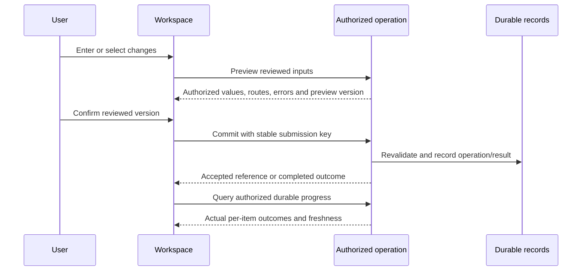

# App component contracts — LAM V2

Status: proposed implementation interfaces for the accepted working screens through D072. Names and properties below are logical design contracts, not authored Canvas controls, supported-property declarations or paste-ready Power Fx. Physical control/property mapping follows the app resources. No tenant setup is requested.

Use the accepted Zurich palette, guided reading order and [screen map](SCREEN-IMPLEMENTATION-MAP.md). [Operation contracts](FLOW-OPERATION-CONTRACTS.md) define data exchanged with the business layer. Actual grants/assignments still control every action; UI capability hints do not authorize backend calls.

## App and screen ownership

The app owns authorized session/context, navigation and operation coordination. Each workspace owns its draft and selection. Reusable components render supplied state and emit deliberate user intents; they do not independently fetch the full register, change business records or approve workflows. Avoid hidden coupling through arbitrary global variables.

Context switch or sign-out invalidates outstanding scoped queries, displayed records and operation capability hints. Unsaved work needs the final discard/retain interaction for that workspace; never carry an old scope's draft silently into a new context. A late response is applied to the screen only when its request/context generation still matches. This prevents an earlier query overwriting a newer scope/search result.

## Shared interfaces

| Logical component | Inputs | Events / outputs | Owning screen responsibilities |
| --- | --- | --- | --- |
| CMP-SHELL | Authorized navigation entries, active context label, current route, user display projection | NavigateRequested(route); ContextChangeRequested | Resolve allowed routes; no access from a visible link alone; task-only entry stays assigned-only |
| CMP-CONTEXT | Authorized context choices, active selection, loading/error state | ContextSelected(contextKey) | Validate requested pair and reset/revalidate scoped state; Global/Super scope handled explicitly |
| CMP-GUIDED-STEP | Title/help, ordered steps, current step, previous/next availability, busy state | PreviousRequested; NextRequested | Own draft; apply step validation; final action is review/confirmation, not a new approval |
| CMP-FIELD-ERRORS | Field/row error targets, summary text, current attempt | ErrorTargetRequested(itemKey, fieldKey) | Present inline messages plus focusable summary after failed submit; preserve entered values; native accessibility mapping follows actual controls |
| CMP-ASSET-SELECT | Authorized page rows, selected identity set, paging/search state, eligible actions | AddRequested(assetKey); RemoveRequested(assetKey); QueryRequested(filter); ViewSelectionRequested | Keep selection across repeated searches; no duplicates; define current-page versus full-result selection; revalidate stale rows |
| CMP-PER-ASSET-EDIT | Selected row identity, before projection, permitted field definitions, draft changes, errors | FieldIntentChanged(itemKey, fieldKey, intent, value); RemoveRequested | Preserve different changes per asset; explicit unchanged/set/clear semantics; do not send hidden unrelated fields |
| CMP-SHARED-VALUES | Chosen row subset and allowed shared fields/values | ApplyDraftValuesRequested(itemKeys, values) | Apply only to draft; show affected rows and preserve later per-row edits; no sale-price allocation or implicit execution |
| CMP-CHANGE-PREVIEW | Versioned reviewed snapshot, per-row prior/proposed values, route, validation findings | EditRequested(itemKey); ConfirmRequested(previewRef, version) | Submit only the reviewed version; confirm handler selects the specific operation; final eligibility and batch policy remain feature contracts |
| CMP-OPERATION-STATUS | Authorized operation reference, freshness, per-row outcome page, counts with completeness metadata | RefreshRequested; OpenItemRequested; RecoveryRequested(itemKey) | Query durable state; do not infer success from a timeout or approval; recovery invokes only a delivered authorized procedure |
| CMP-RESULTS | Item identity, transport/application/approval/certification outcomes, safe messages | OpenEvidenceRequested(itemKey) | Distinguish durable business outcome from service delivery; failures remain visible without duplicating successful work |
| CMP-ASSIGNED-RESPONSE | Exact assigned snapshot, own response draft/version, editability, loading/errors | MarkCorrectRequested; NeedsCorrectionRequested; OpenCorrectionRequested | First activation Correct, second deliberate activation opens correction entry; persistence/cancel/final-submit semantics remain explicit; no timing-dependent double-click |
| CMP-HISTORY | Authorized event page, scope/field policy, freshness and continuation | LoadMoreRequested; RelatedRecordRequested | Historical read does not grant current master access; snapshots use permitted fields only |
| CMP-APPROVAL-CONTEXT | Assigned workflow/snapshot summary, synchronized service state, validated open-link availability | OpenApprovalRequested(attemptRef) | Request/open authorized Microsoft approval context; no competing LAM Approve/Reject event |
| CMP-REPORT-FILTERS | Permitted process/status/due choices, applied filter, query state | FilterChanged; SearchRequested; ExportRequested | Requery counts/results within the same authorized subset; exports cover the defined full filtered result, not only rendered rows |
| CMP-DATA-STATE | Loading, empty, failed or stale status; safe message; last successful timestamp | RetryReadRequested | Distinguish an empty authorized result from failed/unavailable data; retain honest freshness |

Proposed intent representation: omit a field to keep it; explicit set carries a value; explicit clear carries no value. Whether a particular field may clear is determined by its business validation contract, not the shared component. This avoids interpreting an unedited blank control as an instruction to erase stored data.

## Shared data shapes

| Shape | Minimum information | Meaning / boundary |
| --- | --- | --- |
| Session projection | Allowed contexts/routes, task-only participation hint, display identity, server observation time | Client rendering data only; do not accept it back as authority |
| Row projection | Stable record key, record version, allowed display fields and action hints | Only permitted fields; action hints revalidated by backend |
| Draft item | Local item key, subject key, expected version, explicit field intents | Local input is not a saved transaction; business allow-list checked by operation |
| Preview | Opaque reference/version, selected item identities, reviewed before/proposed values, route and safe errors | Bind commit to the exact reviewed input and records; no automatic valid-subset execution |
| Field error | Stable code, safe message, optional authorized item/field target | Unauthorized records receive safe denials without leaked field/value details |
| Operation projection | Durable reference, authorized outcome dimensions, observed time, paged item results and completeness | No operation reference acts as a bearer permission; query rechecks caller visibility |
| Page metadata | Continuation cursor, returned rows, optional complete-result counts and their scope/time | A page count is not a total; exact count can be unavailable |

Money/quantity transport uses proposed exact decimal strings, with business precision/range rules supplied by the feature contract. This is a representation choice, not an accounting formula. Keys/versions/cursors are opaque; the app must not parse them to derive authority or construct storage URLs.

## Screen-to-operation binding

| Screen group | Main operation interfaces |
| --- | --- |
| Entry/context/home | Session.Resolve; References.Query; authorized reporting queries |
| Asset browse/detail | Assets.Query; Assets.Get; Operations.Get for related operation evidence |
| Registration/import | Registration.Preview → Registration.Commit; Import.Validate → Import.Commit |
| Movement | Movement.Preview → Movement.Submit; then durable operation progress; owner decisions handled internally through Microsoft Approvals |
| Disposal | Disposal.Preview → Disposal.Commit; actual per-asset results/history; no approval route |
| Inventory | Inventory.Query; Inventory.Preview → Inventory.Commit for the defined action |
| Stock setup/respond/review | StockCycle.Preview → StockCycle.Create; Assignments.Query; StockResponse.Save; StockReview.Save; stock sign-off preparation/request |
| Reconciliation | Reconciliation.Compare; Reconciliation.PlanSave; Reconciliation.ApplyPreview → Reconciliation.Apply; then final sign-off preparation/request on actual results |
| Reporting/tasks | Reports.Query; Reports.GetProcess; Approvals.OpenContext; Reminder.Preview → Reminder.Send; Export.Request; ReportRefresh.Request when used |
| Administration | Grants.Preview → Grants.Commit; ReferenceChange.Preview → ReferenceChange.Commit under their exact authority |

## Interaction and failure sequence

The sequence is a shared interaction contract, not a new business approval or proof of transaction atomicity. Some operations create a workflow request rather than immediately changing an asset. If a response is lost, resolve the existing submission identity before retrying; a generic Retry must not generate a fresh submission and duplicate a transaction.

## Draft and recovery rules

Keep entered fields and selection after validation failure. On a stale version, show a conflict and current authorized comparison; do not silently replace the user's edits or apply them to an unseen master version. Busy controls prevent accidental repeated activation, while backend idempotency still protects actual requests.

Show unsaved, saved evidence, submitted work and applied results distinctly. Stock response save/cancel behavior remains a feature policy; no component defaults a Correct click into final cycle verification. Reconciliation's final approval sees actual applied outcomes, including unresolved follow-ups according to its eventual readiness rule. Operation-level acceptance is not a blanket All assets completed state.

Component implementation will include native accessible names/focus/keyboard handling, visible non-color statuses and supported mobile layouts for assigned work. Do not paste web ARIA/HTML into Canvas controls as an implementation substitute. Existing runtime/device/security checks remain NOT RUN; component schemas/examples are design validation only.
