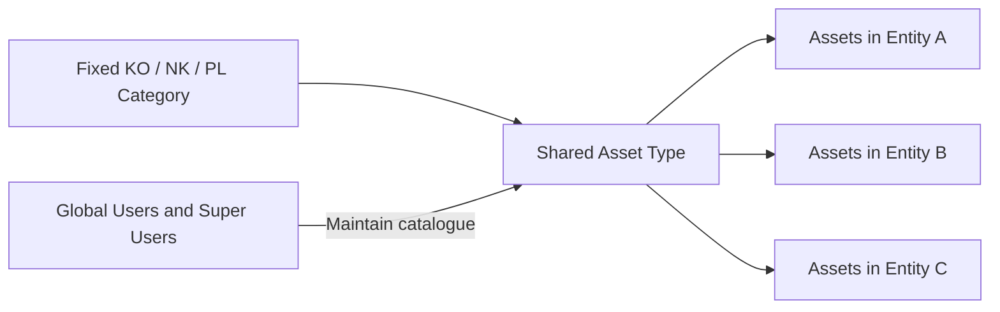

# Asset classification

Status: D047/D048 classification retained; D074 confirms a shared Asset Type catalogue maintained by Global Users and Super Users. This supersedes the former entity-specific catalogue and destination-type mapping in D055–D057. No company list/app/runtime changes were performed by this update.

## Shared hierarchy

Category ← shared Asset Type ← Assets in any Entity/Function. Each type has one CategoryRef; it has no OrganizationRef or FunctionRef. Assets keep their own scope, ownership and permissions.

| Category | Code |
| --- | --- |
| Komputer | KO |
| Non-Komputer | NK |
| Perangkat Lunak | PL |

Accounting account mappings remain deferred and distinct from the company-wide unique Accounting Asset Code. PL describes documented internal software enhancements budgeted as assets, with the same registration fields/lifecycle; no licence/subscription module is implied.

## Maintenance and selection

Both Global Users and Super Users may maintain shared types across the catalogue under D074. This is a specific catalogue exception to Global User's usual entity scope. Other roles select valid existing types for authorized asset operations, without gaining maintenance. Category/Building maintainer authority is not granted by analogy.

Keep editable business fields optional in SharePoint under D044 while forms/controlled writes validate a name, stable key and valid fixed Category parent. Keep CategoryRef single-valued with Restrict delete and the specified index. Physical fields are in [reference columns](../sharepoint/v2/reference-foundation-002/COLUMNS.csv). CategoryCode remains the shared lookup display code, not an Accounting mapping.

Derive/display Category from the selected type or filter the picker by Category. Do not permit inconsistent independently editable type/category pairs. Type naming/duplicate rules and reclassification/deactivation policy remain open; do not merge records solely by matching labels or cascade-delete referenced assets/history. Preserve historical key/label/Category evidence when catalogue data changes. Ordinary edits must not silently reclassify existing assets through a changed Category parent.

## Cross-entity movement

A transfer retains the shared type reference; there is no separate receiving-entity type to create/map merely because Entity changes. If an authorized classification change is explicitly requested, preview/review it under the final field/category rules and retain old/new history. Required outgoing/receiving owner capacities still approve the relevant transfer. Preserve asset identity and Accounting Asset Code; rejection leaves the asset unchanged.

Sharing a type grants no access to assets in another Entity/Function. The reader gallery shows active shared types; business operations continue to enforce their own scope and current-version checks. Original generated visuals/prompts with per-entity type wording are historical and superseded for this rule.

## Remaining details and checks

Type catalogue contents, duplicate-name policy, deactivation/reclassification and protection of referenced records, actual maintenance writer/context bindings and permission tests remain implementation tasks. Planned checks: same type usable across entities, valid Category lookup, Global/Super maintenance without broader operational access, unchanged shared type across transfer, no silent asset reclassification, and current/historical visibility. Runtime NOT RUN.
