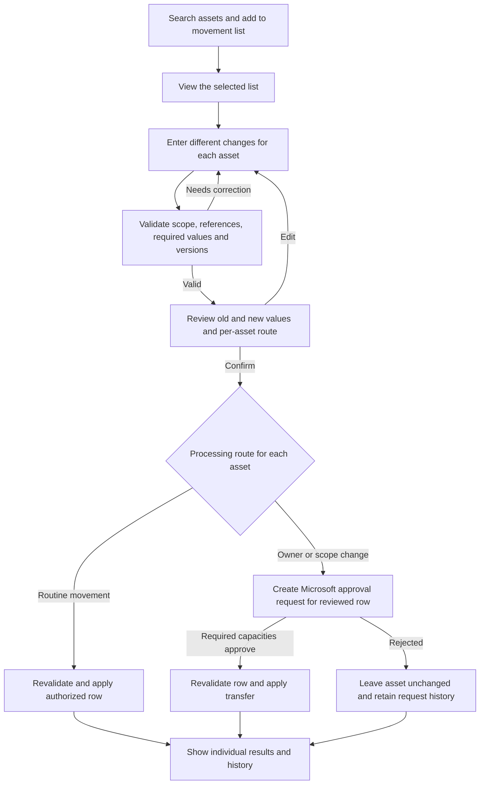

# Asset movement workspace

Status: owner-selected interaction direction D059/D060; visual flow accepted as a working direction under D061. Detailed layout refinements and unresolved batch execution policies remain proposed. Supersedes the detail-first-only navigation described in the conversation. No app code or company resources changed.

## Intended path

Search asset → Add to movement list → View selected assets → Start movement.

View opens the selected-assets list as a whole. It is not a requirement to open each asset's detail. One selection can contain one or multiple assets; authorized detail-page actions can prefill this same workspace as an alternative.

## Proposed interaction

1. Search/filter the existing scoped Asset register. Expose an Add to movement row action and multi-select checkboxes. Adding an asset updates a visible selected count without leaving search; prevent duplicate selection. Users can search again and add another asset without losing prior selections.
2. Show a persistent, compact selection bar such as 5 assets selected with View selected assets. Reviewing an asset's details remains optional. When a selection is active, make the selection's next action primary rather than leaving competing filled calls to action.
3. View selected assets opens one readable review list containing name/accounting code, source entity/function, current type, building, custodian and status as needed. Allow removal and addition without starting again. Keep the list focused on changes that matter; do not scatter every attribute across independent cards.
4. Start movement opens the shared change-entry/review step for those selected assets. Present prior/new values and per-asset validation before final confirmation. No mandatory routine remarks/reason field is introduced. The ordinary movement execution and approval-based transfer submission must have clear distinct outcomes.
5. Preserve the selection and entered changes on validation/service failure so correction does not require repeating searches. Show individual and batch progress/results. Final rules for partial application, retry and recovery remain open; do not imply cross-list all-or-nothing transactions or silently apply a valid subset without an agreed confirmation policy.

## Business rules retained

Location/custodian/status updates that leave entity/function and Business Owner unchanged remain BAU under ordinary authority. Changes of entity/function or Business Owner follow existing outgoing/receiving Business Owner approvals in Microsoft Approvals. A movement list never converts those changes into immediate BAU updates.

For cross-entity transfers, select a valid receiving type within the same Accounting Category before approval, preserve identity/accounting code, and retain old/new references (D057). If different assets involve different owners or routes, keep the correct per-asset approval obligations and restrict each approver's payload to relevant records. Batch-level Approved is not proof that every asset's approvals/application succeeded.

Revalidate authenticated authority, asset/version/state and destination references at submission and application. Existing grants decide selectable/processable records; a global search or destination selector must not reveal unrelated assets. Entity/function session boundaries, Global/Super exceptions and assigned-task visibility remain intact. Mixed-source-scope batch behavior is not yet approved.

Assignment to In Use must obey the custodian rule, including the Custodian-only pending-directory fallback. No approval is routed to that placeholder. Existing audited reopen/reassignment reasons remain exceptions; routine movement still requires none. Record actor/time and prior/new values automatically for each affected asset, with batch correlation for traceability.

## Per-asset changes — confirmed D060

Each selected asset can have different changes and destination values. The workspace must not be common-destination-only. Propose a readable editable list for building/custodian/status, with additional owner/entity/function/type fields expanded inline for the relevant row. Review each asset's prior/new values before final confirmation; no separate detail-page session is required.

Initialize controls with the current values; distinguish an explicit clear action from keeping an existing value. Proposed validation shows row/field errors plus a summary, retains input and returns the user to the relevant row. Exact component behavior remains under visual review.

Proposed illustrated sequence: Select assets → Enter changes → Review and submit → Individual results. See [visual flow](../design/concepts/2026-10-28/asset-movement/README.md). The sample has three valid assets: two routine movements and one owner-change request. The printer's combined changes stay together pending its owner approvals; this is a proposed per-asset grouping policy to review, not evidence of implemented transactional behavior.

Also pending: mixed entity/function source scope, batch limits, status/condition transition guards, per-row change semantics and review of any optional apply-to-multiple shortcut, full-result selection versus current-page selection, stale/unauthorized selection handling, partial execution confirmation, retry/cancellation rules and owner-specific approval grouping.

## Tests to supply with implementation

Repeated searches preserve selection; no duplicate asset rows; add/remove and single-asset entry; selections across paging where supported; visible selected count; unauthorized/stale rows; mixed approval obligations; same-person capacities; valid destination-type mapping; required custodians; no duplicate application after retry; per-asset history and partial failure recovery. All NOT RUN. This selected-assets movement direction does not authorize bulk disposal or modify the already agreed register/import creation rules.

## Proposed processing flow

The diagram omits error paths for readability: creation/application failures, changed versions, cancellation and expiry require explicit per-row failure/recovery states and must not be shown as successful. Mixed batches do not imply all-or-nothing execution. The screenshot's Confirm and submit previews the routine-versus-approval route before any execution; handling an invalid subset or a runtime partial failure is still an open policy/implementation detail.
