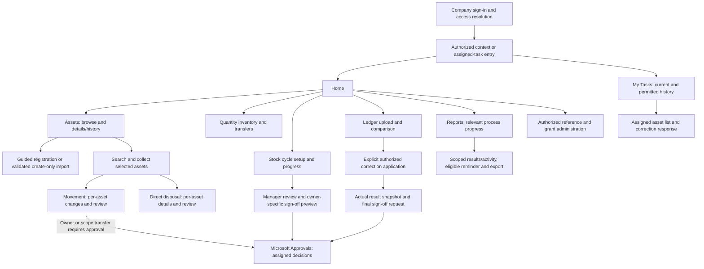
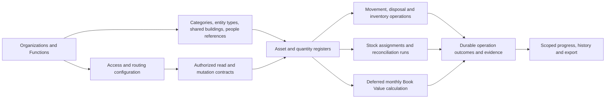

# LAM V2 implementation blueprint

Status: engineering consolidation of confirmed decisions through D072 and accepted working visuals. Build sequencing and logical identifiers below are proposed implementation structure, not additional owner decisions. No V2 app, operational lists or flows have been deployed or runtime-tested by this document.

## Working approach

D072 sets the immediate direction: architecture and implementation-resource design continue without general company-access questionnaires. [SOLUTION-AND-CONNECTOR-ARCHITECTURE.md](SOLUTION-AND-CONNECTOR-ARCHITECTURE.md) records required/planned connectors, access responsibilities and feature dependencies. The owner handles tenant setup and actual bindings when implementing each feature.

Use incremental, contract-first delivery with end-to-end feature slices. Each slice contains the data contract, authorized read/write path, app experience, background work where needed, evidence/recovery behavior and company-run tests. Keep the accepted navigation and reusable presentation consistent while business operations retain their own rules. Do not rebuild all screens first and defer authorization or audit until integration.

Codex designs/develops the resources and cases. The project owner manually implements and tests in company systems. Company Claude provides Q&A based on supplied files/observations and has no direct Power Platform visibility or assumed GitHub access. Every new transfer prompt uses the existing [prompt template](../prompts/TEMPLATE.md), including its concrete GitHub response path.

The three delivery roots remain Power Apps, Power Automate and Others. The 88 supplied source files, 30 baseline YAML guides and 15 baseline flow handovers are historical references; their count does not define the target screen/flow count. Use accepted target decisions over contradictory legacy behavior. Preserve originals and identify replacement scope explicitly.

## What is settled and what is still open

| Area | Confirmed direction | Implementation boundary still to resolve |
| --- | --- | --- |
| Platform | Canvas app, dedicated SITE-A V2 SharePoint data, Power Automate; Microsoft Approvals for retained decisions | Backend isolation/identity, operational schema, connections, packaging and company environment readiness |
| Access | Ordinary entity/function grants; Global User within entity; Super User across all; assigned current/historical participation | Direct data access enforcement, revocation, exact historical fields and Viewer assignment semantics |
| Registration | Generated LAM tag; company-unique Accounting Asset Code available at registration; Available initial status; Good default; IDR | Tag format/allocation, final D058 field review, uniqueness/concurrency and monthly formula/initial-value contract |
| Movement | Search/add/select → per-asset changes → review/submit; different changes per asset | Mixed-source batches, operation grouping, invalid subsets, partial outcomes and recovery policy |
| Disposal | Single/batch; per-asset details; optional shared date/buyer; per-asset sale price; no disposal approval | Buyer representation, mixed modes, overwrite behavior, eligibility/archive and failure recovery |
| Stock verification | List-first assigned response; correction detail updates assignment only; manager review; owner-specific sign-off | Persistence/cancel/submission semantics, verification criteria, closure/reapproval details |
| Reconciliation | Compare/review → explicit authorized apply → final Accounting/Governance sign-off on actual results (D070) | Ledger/matching/correction fields; unresolved-follow-up eligibility; final rejection/rework/rollback |
| Reports | Accepted scoped progress/detail flow; authorized exports and eligible respondent reminders (D071) | Metrics/deadlines, fields/formats, refresh architecture, reminder delivery/rate limits |

Categories stay KO/NK/PL; Asset Types are entity-specific with Category lookup; buildings are shared and building-only. Custodian is an individual directory employee with the Custodian-only pending-registration option. Do not apply that placeholder to owners/approvers. Condition remains Good/Broken/Ready to Auction, distinct from lifecycle and process states.

## Target screen map

This consolidates existing flows; it does not add permissions. Logical screen IDs and step boundaries are in [SCREEN-IMPLEMENTATION-MAP.md](SCREEN-IMPLEMENTATION-MAP.md). A wizard step or detail tab may share a physical Canvas screen after responsive/control design; logical IDs are not a final screen count.

Routine movements follow their own authorized application path. The diagram's transfer arrow applies only to changes requiring approval. Disposal and quantity inventory do not gain asset-style approval routes. A task-only participant is not routed through a general operational dashboard or register. Approval assignment is validated separately from general reporting access.

Visual references: [movement](../design/concepts/2026-10-28/asset-movement/README.md), [details/disposal](../design/concepts/2026-10-28/asset-details-disposal/README.md), [assigned stock responses](../design/concepts/2026-10-28/stock-verification-respondent-list/README.md), [manager/owner review](../design/concepts/2026-10-28/stock-verification-manager-review/README.md), [apply-first reconciliation](../design/concepts/2026-10-28/reconciliation-apply-first/README.md), [reporting](../design/concepts/2026-10-28/reporting-progress/README.md). Earlier reconciliation approval-first images are superseded for ordering.

## Responsibility boundaries

| Layer | Responsibility | Concrete output before a slice is implemented |
| --- | --- | --- |
| Presentation | Guided entry, selection, old/new preview, accessible feedback, scoped progress | Screen/control contract, formulas, reusable components, field/error behavior and navigation |
| Business operation | Authoritative identity/grants, state/reference/field validation, workflow-specific prerequisites, version and retry handling | Operation inputs/outputs, authority rules, errors, evidence, concurrency/recovery contract |
| Data | Entity/function integrity, references, identity/history, durable operations and evidence | Exact lists/internal names/types/indexes/constraints, permission model and approved synthetic bindings |
| Background orchestration | Import/comparison, approval lifecycle, reminders, exports, monthly calculation where applicable | Per-flow trigger/response and connection configuration; durable status and failure recovery |
| Reporting | Authorized subsets, accurate outcome counts, historical visibility and freshness | Scoped query/aggregation/export contracts; final field/metric definitions |

This is a logical separation, not a commitment to custom APIs, premium services, a new database or one flow per action. Choose the supported company mechanism after confirming capabilities. Do not trust role/email/entity arguments from a client, and do not expose a privileged service connection as an unchecked write proxy. Client-side filters and hidden buttons are not the authorization contract.

Required business fields remain optional SharePoint business columns under D044 and are guided/validated in Power Apps. The authorized mutation path must also reject invalid or unauthorized submissions so alternate entry points cannot defeat those rules. Unique constraints and reference integrity are distinct from SharePoint Required flags. Do not invent initial Book Value or implement the deferred formula by copying ledger values.

## Shared presentation components

[APP-COMPONENT-CONTRACTS.md](APP-COMPONENT-CONTRACTS.md) now specifies logical inputs/events, shared data shapes, screen bindings and draft/error/recovery responsibilities. [FLOW-OPERATION-CONTRACTS.md](FLOW-OPERATION-CONTRACTS.md) and the [machine-readable interface resources](interfaces/README.md) define proposed named request/output contracts. These are design resources, not authored controls or deployed flows.

Proposed component responsibilities; exact Power Apps properties/control choices follow the app foundation slice.

| Component | Shared responsibility | Keep workflow-specific |
| --- | --- | --- |
| Application shell | Brand tokens, authorized navigation, context display, back/breadcrumb behavior | Actual grants/task participation determine destinations |
| Context selector | Show only authorized contexts; clear/revalidate stale selections when switching | Task-only access does not acquire a general context |
| Guided form step | Heading/help, labeled fields, inline errors plus summary, previous/next actions | Requiredness, business validation and final review fields |
| Asset selection list | Search/add/remove, selected count, duplicate prevention, return path | Scope, eligible assets, batch limits and each operation's draft |
| Before/after preview | Record identity, changed values, validation and applicable route | Financial, movement, disposal and reconciliation rules |
| Status/progress panel | Text plus non-color cues, timestamps, pending/failed/stale states | Response, verification, application and certification are separate dimensions |
| Result list | Per-row applied/failed/conflicted outcomes and safe recovery entry | No implied cross-row atomicity or automatic failed-row retry policy |
| Evidence/history view | Authorized chronology, actor/time, versions and related operation links | Historical field visibility, attachments and retention |
| Loading/empty/error view | Honest data freshness, accessible recovery and correlation reference | No silent fallback to broader cached data |

Reuse appearance and simple interactions; do not put every workflow into one configurable form or duplicate business validation across unrelated buttons. Pending prototypes must not be mistaken for connected production controls. Apply the accepted palette/spacing and guided reading order; original approved logo/icon assets and company accessibility testing remain dependencies.

## Data and operation dependency map

The [operational data model](OPERATIONAL-DATA-MODEL.md), [logical field contract](../sharepoint/v2/OPERATIONAL-DATA-CONTRACT.json) and [glossary](GLOSSARY.md) now specify proposed target entities, relationships and minimum fields. Only [Organizations and Functions](../sharepoint/v2/README.md) currently have creation-ready physical field contracts. The following are logical responsibilities, not permission to create named operational lists. Durable audit/recovery is required alongside the first writer.

Specify operation correlation/idempotency, record versions, validation errors, accepted-versus-completed state and per-row results before writing integration formulas. A client timeout is an uncertain outcome to reconcile using a durable operation identity, not permission to repeat a write blindly. No multi-row or multi-list atomicity is assumed. Preserve request/apply outcomes independently of approval-service responses.

For background work, return/retain an operation reference and show durable progress rather than holding the user experience open for long human decisions. Final technical invocation/status shapes depend on the chosen backend. Use [BUILD-SEQUENCE-AND-GATES.md](BUILD-SEQUENCE-AND-GATES.md) for each slice's concrete prerequisites and acceptance evidence.

## Flow responsibility inventory

These responsibility IDs are planning labels, not deployed names or a promised number of flows. A delivery may combine/split responsibilities after reviewing authentication, platform limits and recovery needs. The existing [15-flow baseline](../../Power%20Automate/README.md) remains reference material.

| Logical responsibility | Caller or event | Required durable outcome |
| --- | --- | --- |
| OP-ACCESS | Startup, context/read/action authorization | Validated grants/participation and safe denied/unavailable result |
| OP-REGISTER | Explicit single create or confirmed valid import rows | Unique identity/code, initial-state validation, attributable per-row create outcome |
| OP-MOVE | Reviewed per-asset movement | BAU result or linked transfer request; actual application/history separately tracked |
| OP-TRANSFER-DECISION | Required Microsoft approval attempt/response | Owner capacities, immutable reviewed scope, version validation and applied/rejected/failed result |
| OP-DISPOSE | Explicit reviewed one/many-asset confirmation | Actual per-asset lifecycle/history outcome with no disposal approval |
| OP-INVENTORY | Authorized quantity creation/transfer | Valid quantities, scope/concurrency controls and history |
| OP-STOCK | Setup, assigned save/submit, manager review | Assignment-only evidence, versions and review/verification outcomes |
| OP-STOCK-SIGNOFF | Eligible owner-specific summary | Configured decision evidence and exception-aware completion, not automatic master correction |
| OP-RECON | Ledger validation/compare and explicit eligible apply | Provenance, findings and actual correction outcomes |
| OP-RECON-SIGNOFF | Versioned actual results after application | Final Accounting/Governance decisions under D070; rejection/rework policy still open |
| OP-REMIND-EXPORT | Authorized standard reminder or scoped export | Recipient/file scope, attributable delivery/job result and protected access |
| OP-BOOKVALUE | Start-of-month schedule after finance contract approval | Versioned formula/run/input/output and per-asset recovery evidence |
| OP-REPORT-REFRESH | Authorized progress query or report-refresh action | Actual freshness/job outcome; app refresh and Power BI dataset refresh remain distinct |

## Delivery and implementation status

Current stage: accepted working UX direction, partial foundation data contract, implementation blueprint prepared. SITE-A completion, backend access strategy, operational schemas, approval provisioning/connections and approved test identities remain company/design dependencies. ENV-A contains the blank new app; ENV-B availability is reported, but no isolated development/test setup is confirmed. Do not infer that ENV-B is ready or promote anything automatically.

The first access/data design is now recorded in [the authorization contract](ACCESS-AND-AUTHORIZATION-CONTRACT.md), [backend feasibility findings](BACKEND-ACCESS-FEASIBILITY.md) and [draft principal/grant fields](../sharepoint/v2/ACCESS-GRANT-COLUMNS-DRAFT.csv). These are reviewable proposals, not creation-ready operational contracts. The proposed operational entity/field design is now available in [OPERATIONAL-DATA-MODEL.md](OPERATIONAL-DATA-MODEL.md). App/component and flow input/output contracts are now recorded in [APP-COMPONENT-CONTRACTS.md](APP-COMPONENT-CONTRACTS.md) and [FLOW-OPERATION-CONTRACTS.md](FLOW-OPERATION-CONTRACTS.md), with schemas/examples in [interfaces](interfaces/README.md). Next prepare feature-specific physical data mappings and app/flow resources, retaining explicit unresolved business gates. Record trusted identity/backend requirements as implementation dependencies to bind and verify with the affected feature. The [capability-check prompt](../prompts/PENDING-003-access-capability-check.md) is DEFERRED under D072; it is not a prerequisite or requested next action. Tag allocation and first Book Value behavior must be settled before a real registration write; the financial screen may remain an explicit unimplemented concept in the meantime. Site-independent contracts, disconnected UI resources and synthetic local checks can continue while company setup is pending.

Follow [build sequence and gates](BUILD-SEQUENCE-AND-GATES.md), the [backlog](../requirements/IMPLEMENTATION-BACKLOG.md), [single-operator UAT kit](../testing/README.md) and [handover operating model](../handover/START-HERE.md). No acceptance of a mockup substitutes for runtime/security evidence. The user runs approved cases; unresolved Critical/High defects or required blocked acceptance cases prevent declaring the release accepted.
