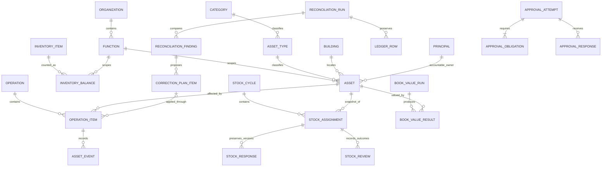

# Operational data model — LAM V2

Status: proposed engineering design derived from confirmed decisions through D072. Continue design without tenant setup questionnaires. No company lists have been created, connected or migrated. The logical entities below are responsibilities, not a requirement for one SharePoint list per entity. Field-level proposals are in [OPERATIONAL-DATA-CONTRACT.json](../sharepoint/v2/OPERATIONAL-DATA-CONTRACT.json); terms are defined in [GLOSSARY.md](GLOSSARY.md).

## Model at a glance

The diagram omits secondary references for readability. Ownership, custody, physical building and operating Function are independent relationships. Current state, submitted observations, decisions and actual writes remain separate facts.

## Proposed entity catalogue

| Group | Logical entities | Purpose / relationship |
| --- | --- | --- |
| Reference | Organization, Function | One Organization per Function; existing foundation contracts retained |
| Reference | Category, AssetType, Building | Fixed KO/NK/PL; shared types with Category parent (D074); shared building-only locations |
| Identity/access | Principal, AccessGrant | Actual directory-backed identities and scoped roles; see existing access contract |
| Asset register | Asset | One stable asset identity and authoritative current state; history remains linked after transfer/disposal |
| Quantity inventory | InventoryItem, InventoryBalance, InventoryEvent | Item kind separate from scoped quantity and transfer history; not a row per physical unit |
| Business operations | Operation, OperationItem, AssetEvent | Correlate selected batches, preserve reviewed per-row changes and actual outcomes; events preserve before/after evidence |
| Stock verification | StockCycle, StockAssignment, StockResponse, StockReview | Assigned snapshots, versioned respondent observations and distinct manager verification/exception outcomes |
| Reconciliation | ReconciliationRun, LedgerRow, ReconciliationFinding, CorrectionPlanItem | Retain input/period/source, comparison evidence, reviewed dispositions and links to actual correction operations |
| Workflow decisions | ApprovalAttempt, ApprovalObligation, ApprovalResponse | Versioned review snapshot, required capacities and actual named decisions; no disposal approval route |
| Monthly finance | BookValueRun, BookValueResult | Versioned formula/period inputs and per-asset calculation/application outcomes |
| Supporting work | DocumentReference, NotificationDelivery, ExportJob | Scoped files/source evidence, attributable notification attempts and protected export results |

The JSON contract records proposed minimum field sets across the logical catalogue, with more detailed business rules for reference catalogues, Asset, inventory balances, Operation/OperationItem and stock evidence. Physical field mappings and complete workflow-specific transition contracts follow with their feature delivery. Do not treat the catalogue as an empty-list creation checklist.

## Stable identity and current records

Propose a generated immutable AssetKey independent of the visible Asset Tag and Accounting Asset Code. Use it to join transactions/history across changes in type, Entity/Function or ownership. Tag formatting/allocation remains deferred. Duplicate serial numbers remain allowed. Accounting Asset Code must be supplied at registration and company-unique; normalization/case/whitespace and disposed-code reuse rules remain open. Do not enable reuse or silent merging by assumption.

A proposed Asset row retains current scope, type, building, owner, custody, condition, lifecycle and financial-result references. Prefer retaining the stable asset row after disposal and excluding Disposed records from the active register. This is a proposed physical design choice, not a newly confirmed business requirement; a linked retained-identity/archive implementation must preserve equivalent identity/history if later selected. No ordinary disposal physically deletes evidence.

Category is derived through AssetType, not independently editable on Asset. Preserve Category/type labels and keys in historical snapshots so later catalogue edits cannot rewrite prior evidence. Propose preventing re-parenting an in-use type's Category through ordinary catalogue editing until a reviewed reclassification contract exists. Shared buildings have no exclusive Entity/Function parent and contain no floor/room fields.

## Asset field rules

| Field group | Proposed content | Business rule / open detail |
| --- | --- | --- |
| Identity | AssetKey, AssetTag, AccountingAssetCode and canonical matching key | Immutable internal identity; generated tag; code required and company-unique; canonicalization/tag details deferred |
| Scope | OrganizationRef, FunctionRef and validated scalar scope keys | Function parent and acting user's scope must match; scalar query keys are maintained by the operation, not freely edited |
| Classification | AssetTypeRef | Shared type has valid fixed Category parent; cross-entity transfer retains it unless an authorized classification change is explicitly reviewed (D074) |
| Description | AssetName, optional SerialNumber and ManufacturerModel | Name required provisionally under D058; serial duplicates permitted; no separate PL form |
| Assignment | BuildingRef, BusinessOwnerRef, CustodianState and optional CustodianRef | Building/owner provisional required fields; owner actual directory identity; pending fallback only for Custodian |
| State | AssetStatus and Condition | Available at create; Good default without overwriting deliberate valid choice; Condition exactly Good/Broken/Ready to Auction |
| Purchase | PurchaseDate, PurchaseCost and CurrencyCode | Date/cost required; IDR fixed; precision/range/date rules still to be finalized |
| Valuation | LatestBookValue and latest calculation period/result reference | Formula-produced result; nullable/unavailable until defined; never invent zero/purchase-cost initial value or copy ledger automatically |
| Evidence/version | Created/last-change operation references; record version; linked documents | Attributable current state and durable before/after history; physical storage/version bindings later |

Proposed CustodianState values are None, Directory and PendingDirectory. Available can have none or a valid supplied choice. In Use requires Directory or the explicit pending fallback; the exact validation/pending presentation follows the employee design. Pending does not contain a fake principal or authorize task routing. Disposal does not imply clearing a custodian without a defined state rule.

All editable business fields stay optional at the SharePoint Required setting under D044. Requiredness is expressed in the application and validated mutation contracts. The JSON contract uses logical data types; it does not finalize SharePoint money/quantity precision or physical choice names. User confirmation of D058's provisional registration fields still belongs in the registration review, not a setup questionnaire.

## Inventory boundaries

InventoryItem describes what is counted; InventoryBalance identifies the authorized Entity/Function's quantity of that item; InventoryEvent retains prior/new balances and the linked transfer operation. Do not reuse AssetType or AssetTag just because an inventory label resembles an asset description. Item catalogue scope, units, optional building dimension, fractional quantities and quantity-adjustment permissions remain open; no fixed global/entity catalogue or per-location balance is inferred.

The proposed balance key covers the finally approved dimensions; it must prevent two active balances for the same scope/item/dimension tuple. Cross-scope transfers link source/destination effects through one operation item, validate both scope rules and record partial/uncertain writes honestly. No asset-style dual-owner approval is added. Quantity calculations require concurrency/version control; batch success is not inferred from one successful deduction.

## Selected batches, transactions and history

An Operation correlates an explicit business submission. An OperationItem represents one selected asset's change or one inventory transfer, including reviewed before/proposed-after data, versions, route and actual application result. Asset movement/disposal retain different inputs per asset. Applying a shared disposal date/buyer only changes the draft until final confirmation; sale price stays per asset.

Do not put one destination/owner/status on a batch header and overwrite every asset with it. The header's display context does not authorize all contained rows. Mixed-source-scope selection, invalid-subset confirmation, execution grouping and partial-failure policy remain open; the model supports per-row evidence without approving those policies.

AssetEvent and InventoryEvent retain actor/time, operation/item identity, prior/new evidence and outcome. They are business histories alongside current records, not a mandate to implement event sourcing or reconstruct every read by replaying events. Durable operation records also distinguish accepted, applying, applied, failed, conflicted and uncertain concepts; final physical states/transitions follow operation contracts.

For uncertain writes, reconcile the operation identity and stored record version before retrying. Updating a master and recording evidence are not assumed atomic across stores. Include recovery that detects a written master whose outcome/event record is incomplete; do not silently report success or blindly repeat it.

## Stock verification evidence

StockCycle owns scope/selection criteria, due-date policy and its assignments. StockAssignment links one asset snapshot and a named participant/capacity for a cycle. Reassignment preserves the former assignment and history, creates or versions the replacement association, and never moves an asset's entire future master record into the former assignee's visibility.

StockResponse preserves each submitted/saved observation version against that assignment: Correct or corrected observations, evidence and actor/time. The latest permitted response can be presented efficiently, but prior evidence is retained. Whether every click is immediately durable, cancellation returns to a previous state, and final submission locks a response remains the accepted interaction's pending persistence contract.

StockReview records manager review/verification/exception outcomes separately. Correct submitted does not itself write Verified; Reviewed does not imply Verified; an acknowledged unresolved exception stays unverified even after permitted cycle closure. Master correction is a separate authorized OperationItem with its own prerequisites, not a StockResponse field update.

## Reconciliation and final sign-off

ReconciliationRun retains source file/version, accounting period, matching/rule version and register/calculation snapshot references. LedgerRow preserves source row identity and validated raw/normalized values. ReconciliationFinding points to the actual source/register evidence, allowing matches, missing-on-either-side, value/quantity differences and disposed exceptions without automatic mutation.

CorrectionPlanItem records the reviewed disposition and eligible before/proposed-after fields; actual changes link to OperationItems. Under D070 the order is compare/review → explicit authorized apply → final Accounting/Governance sign-offs on actual results. The final review snapshot references real applied/failed/conflicted/follow-up evidence, not an assumption that every planned correction succeeded.

Missing-register findings route to authorized create-only registration; disposed exceptions retain disposal evidence; owner/scope changes keep their pre-transaction approvals. Financial field eligibility remains deferred with the formula contract. Final rejection/rework/rollback and readiness with unresolved follow-ups remain open; no automatic reversal is implied by the data model.

## Decision evidence

An ApprovalAttempt identifies a workflow instance, exact review snapshot/version, service approval IDs and attempt lifecycle. ApprovalObligations identify required capacities, named eligible identities and relevant subsets. ApprovalResponses retain actual responder, decision/time and supersession evidence.

Two distinct owner capacities can be satisfied by one explicit response when the same authorized person holds both; model the link to both obligations rather than requiring two clicks or auto-approving. General Super/Global privilege supplies no assigned decision by itself. No approval entities are created for direct disposal or quantity transfers merely because shared orchestration exists.

## Monthly values, files and reporting

BookValueRun identifies formula version and accounting period; BookValueResult retains per-asset inputs/version, calculated value, previous value and actual application outcome. A normal retry uses the same per-asset/period operation identity; authorized recalculation needs explicit versioning. The formula, initial value, precision, schedule time zone, eligibility and catch-up rules remain deferred. Asset's latest value is a result projection, not the only finance history.

DocumentReference links a file/version to an authorized asset, assignment, run or operation, with its own scoped visibility. File storage, response snapshots and report exports must not expose unrelated owners/entities through a shared parent. NotificationDelivery records relevant recipients and actual delivery attempts separately from business state. ExportJob identifies the authorized filter/subset, field policy, output and download access; exact format/retention remains open.

Reports derive from authorized current records, process outcomes and immutable evidence as appropriate. Keep asset counts, request counts, response counts, verified counts, findings and approval capacities distinct. Header totals and activity cannot reveal a hidden subset. D071's progress view reads this evidence; a reminder or report refresh does not mutate business responses/status.

## Query keys and physical mapping

Propose stable keys for each logical entity and validated scalar scope/run/asset keys on growing operational/history records, alongside genuine reference relationships. Record which value is authoritative and maintain query projections through the operation so duplicate scope values cannot drift. Snapshot labels are evidence, not routing keys.

Map small reference relationships to final lookup contracts. Choose query/index/partition, joins, JSON-versus-structured field layout, version checks, date/time and financial precision in each physical list/flow delivery. Avoid a single unqueryable payload as the only source of reportable rows. Do not replicate lists by Entity or introduce one unique permission scope per asset as an unstated requirement.

The model targets approximately 5,000 assets and growing history, not a client-side full-register collection. Follow [scale/query requirements](../sharepoint/v2/SCALE-AND-QUERY-REQUIREMENTS.md), [access contract](ACCESS-AND-AUTHORIZATION-CONTRACT.md), [connector architecture](SOLUTION-AND-CONNECTOR-ARCHITECTURE.md) and [build sequence](BUILD-SEQUENCE-AND-GATES.md). Company bindings and security/performance tests occur during implementation under D072, while the design proceeds now.

## Scenarios checked against the design

| Scenario | Required separation/outcome |
| --- | --- |
| Same shared building, different Entities | Common Building reference; separate scope/ownership and no access expansion |
| Cross-entity movement | Same AssetKey/tag/accounting code; same shared type retained absent an explicit authorized classification change; old/new scope evidence; required owners approve before application |
| Custodian pending for two assets | Two independent pending assignments, not one invented employee identity; later explicit resolution per asset |
| Respondent corrects building | Versioned observation only; master changes only through a separate authorized operation |
| One row fails in a batch | Successful/failed/uncertain rows retained separately; no invented atomicity or duplicate retry |
| Same person holds both owner capacities | One explicit decision linked to two required obligations |
| Asset disposed then appears in ledger | Retained identity/disposal history; finding, not automatic reactivation or duplicate registration |
| Reconciliation applied but final sign-off rejected | Actual writes/evidence remain recorded; rejection policy remains open, not assumed rollback |
| Monthly flow retried after timeout | Same period/asset operation reconciled; no blind duplicate adjustment |
| Former respondent opens historical assignment | Permitted old snapshot/history only; no later master or replacement-response access |

These are design consistency checks, not runtime test results. Existing cases remain NOT RUN. Implementation-specific cases accompany the corresponding physical resources.
