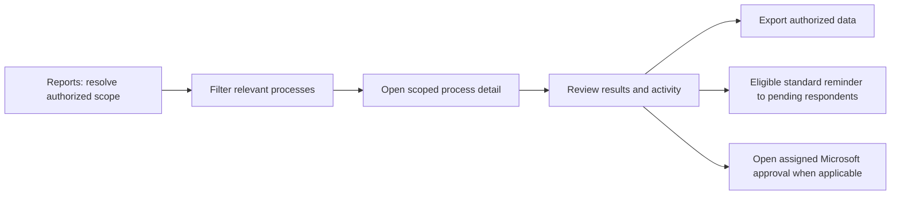

# Reporting and process progress — proposed detailed flow

Status: proposal for owner review, extending confirmed D014/D016/D018–D020, D035, D039, D042 and D070. No new permissions, field contracts or company resources are established by these screens. No runtime tests have run.

## Proposed sequence

Reports → Request progress → Filter relevant processes → Open scoped process detail → Review outcomes/activity → Export authorized data or send an eligible standard respondent reminder.

[Two-screen visual proposal](../design/concepts/2026-10-28/reporting-progress/README.md).

## Confirmed scope boundaries

- Business Owner sees relevant owned-asset progress even when someone else initiates the work, limited to authorized details. A mixed-owner request must not expose unrelated assets, counts, identities or activity through its summary, search, deep link or export.
- Asset Manager has authorized operational reporting. Global User has its entity scope; Super User has application-wide scope. These application roles do not establish company Power Platform maker permissions.
- Viewer exports assigned data within its authorized read scope and cannot edit business data. Respondent reads/exports assigned current/historical data and edits only its open responses. A reporting entry point supplies no new register-wide access.
- Business Owner and Asset Manager may send standard reminders to relevant pending respondents. Sending a reminder does not answer, reopen, reassign, approve or change business status.
- Microsoft Approvals remains the decision surface. Reporting visibility is not proof of authority to approve a particular workflow step.

Exact historical visibility, Viewer assignments, revocation behavior and field lists remain to be specified. Resolve the effective grants and explicit participation rather than trusting a client-selected role or scope label.

## Reporting hub

Propose Request progress as the landing tab, with Asset overview and History as sibling views. Only Request progress and one stock-detail view are illustrated here; neither sibling tab establishes a finished dashboard contract.

Show active authorized context and the visibility basis, such as Your assets only. Provide labeled process-type/status/due filters and request-ID search. Changing context must clear/revalidate prior selections and cached results; back navigation should restore only still-authorized filters.

Each row shows process identity/type, current stage, the caller's visible asset outcomes, applicable due date and View. Do not require opening each asset to understand a process. Retained historical work stays available within the agreed historical access boundaries.

Show separate measures rather than a universal completion percentage:

| Workflow | Example visible outcome | Separate workflow state |
| --- | --- | --- |
| Asset movement | 0 of 2 visible assets moved | Awaiting required owner approvals, applying, applied or failed |
| Stock verification | 2 of 5 visible assets verified | Collection, manager review and relevant owner sign-off |
| Reconciliation | 1 of 1 selected eligible correction applied | Final Accounting/Governance sign-off pending/decided on actual results, under D070 |
| Direct disposal | Actual per-asset disposal outcomes | Transaction success/failure/history; disposal request/approval remains retired |
| Inventory | Authorized item quantities and transaction outcomes | No asset-style dual-owner approval added |

The first three rows are illustrative, not the final status vocabulary. Request counts, asset counts, approval-capacity counts and findings are different measures. The example's Awaiting approvals card counts two visible processes, not individual recipients. Cards may overlap. Define production counting, due-date and mixed-subset rules before implementation; do not infer unseen process-wide state from a restricted subset. Display scoped-stage information only when safe and meaningful.

Do not invent a mandatory movement/reconciliation due date: example dates illustrate placement pending the final workflow deadline contract. An overdue flag needs a defined applicable deadline, clock/time zone and terminal-state rule, not merely an old date on any record.

## Process detail and follow-up

The stock-verification example shows only the Business Owner's five relevant assets: two verified, one requiring manager review and two without responses. A respondent's Correct assertion is distinct from the manager's recorded verification outcome. The example's outcomes are a convenient partition; the final response/review state model is still open.

Collection and review may overlap. Show stages honestly rather than implying every earlier stage completed. Owner sign-off is Not requested in this example; pending/unresolved items do not become verified through a reminder, approval or closure. D035's acknowledged unresolved exceptions remain visibly unverified after closure.

Results and Activity should retain evidence versions and links to separate authorized operations. Viewing progress does not mutate master data. An approver can open the relevant assigned Microsoft approval when one exists and authority is validated; do not display competing Approve/Reject buttons in LAM.

For reconciliation, show applied/failed/conflicted/follow-up outcomes separately from final certification. D070 places explicit authorized application first. Existing owner/scope-transfer approvals still precede those particular transactions. Final rejection/rework/rollback and unresolved-follow-up sign-off eligibility remain open.

## Reminders

Propose a clearly labeled action with a preview of the eligible pending recipients within scope and a standard message. Revalidate sender and recipient eligibility at execution. The visual's two pending respondents are synthetic; production deduplication across tasks, reminder preview/confirmation, notification channel, rate limits and retry behavior remain design gates.

Show actual queued/sent/failed outcomes under the eventual delivery contract; clicking a button is not evidence of delivery. Record actor/time, relevant task correlation and outcomes without changing responses or workflow state. Do not extend respondent reminders to arbitrary Accounting/Governance or Business Owner approval reminders without a confirmed policy.

## Exports and freshness

Propose Export filtered data at the hub and Export visible data in detail. Visible means the full authorized filtered result set under the final export contract, not just the current rendered page. Exact formats, included fields, grouping, attachment handling, limits and expiry/retention are open. Backend authorization must match the rows/fields the caller may read, with protection against mixed-owner and historical-data leakage. Handle scope changes/revocation during queued work and reauthorize download access under the final contract. Do not create an unrestricted sharing link by copying the baseline export mechanism.

Display actual refresh timestamps and a clear loading/empty/failed/stale state. Refreshing the app's reporting data and refreshing a Power BI dataset are separate operations; neither a click nor acceptance of a refresh job proves completion. The mockup does not choose a Power BI architecture, authorize tenant access or establish a refresh schedule.

Complete counts and exports must cover paging/index/query limits at the expected approximately 5,000-asset scale plus growing process history. Never label a partial connector page as a complete report. A failed refresh must not silently show stale data as current.

## Planned validation — all NOT RUN

Use the existing [solo UAT kit](../testing/SOLO-UAT-RUNBOOK.md), especially RPT-01..06, AUTH-02/07/08/09, SO-06/07, REC-02/04/06 and UX-02/04. The screenshots use independent illustrative data, not the kit's exact seed fixture. Validate backend isolation, mixed-owner summaries/activity/counts, copied URLs, role/context changes, assigned historical exports, complete paging and filtering, stale/failed refresh, duplicate reminder attempts, correct pending recipients, no response/status change from reminders, applied-versus-final-sign-off states and mobile/keyboard access. Capture real outcomes later; this proposal records no test pass.

## Remaining gates

Owner feedback on layout/path; report fields and business metrics; per-workflow stages/deadlines; mixed-owner summary semantics; historical access/retention; export format and download authorization; reminder channel/rate limits; Power BI/reporting architecture and refresh contract; backend query/index/paging design; final reconciliation rejection/rework policy. Accepted business requirements remain authoritative while these details are reviewed.
