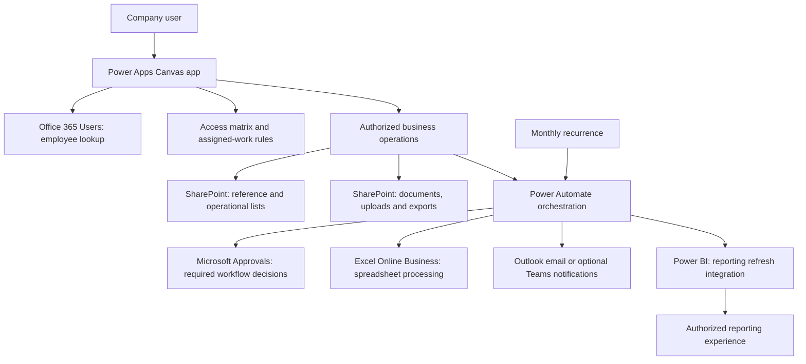

# LAM V2 solution, connectors and access architecture

Status: architecture design under owner direction D072. Continue designing schemas, screens, components and flows now. The owner handles tenant access, connector setup and bindings when implementing each feature; access/capability questionnaires are not design prerequisites. This document is the implementation dependency reference, not a request to configure anything now.

D073 changes the SharePoint host to SITE-F, the existing Function site. Dedicated LAM lists/libraries remain separate from host content; see [shared-site layout and permission setup](../sharepoint/v2/SHARED-FUNCTION-SITE-SETUP.md). The host Function does not restrict LAM's multi-entity business scope.

## Solution structure

Access evaluation and business operations are logical responsibilities, not an additional purchased product. The physical read/write mechanism is documented in the [access contract](ACCESS-AND-AUTHORIZATION-CONTRACT.md) and [backend alternatives](BACKEND-ACCESS-FEASIBILITY.md). Directory lookup does not grant authorization; app sign-in is not implemented by querying an employee email.

## Connector inventory

Required/planned below describes the design, not a claim that a company connection exists. Where a choice remains open, keep the dependency explicit and continue independent design work.

| Connector / platform capability | Design need | Where it is used | Access/binding to document for implementation |
| --- | --- | --- | --- |
| [SharePoint](https://learn.microsoft.com/en-us/connectors/sharepoint/) | Core | Reference data, assets, inventory, requests/assignments, operation outcomes/history; proposed document libraries for uploads/evidence/exports | SITE-F, dedicated LAM list/library identifiers, permitted reads/writes and reference relationships; separate ordinary-user authority from controlled operation identity |
| [Office 365 Users](https://learn.microsoft.com/en-us/connectors/office365users/) | Core for chosen directory-backed people selection | Custodian and other actual employee identity lookups in the app; profiles needed by routing | User-directory connection and only needed profile fields; profile-read operations, no profile administration; pending-directory placeholder allowed only for Custodian |
| [Standard approvals](https://learn.microsoft.com/en-us/connectors/approvals/) | Core retained workflows | Asset owner/scope transfers; stock Business Owner sign-off; reconciliation final Accounting/Governance sign-off | Flow connection/environment and named workflow capacities; durable approval ID/attempt/snapshot/response evidence in LAM |
| [Excel Online (Business)](https://learn.microsoft.com/en-us/connectors/excelonlinebusiness/) | Planned spreadsheet integration | Bulk registration and accounting-ledger ingestion when the final template uses Excel workbooks/tables | Approved SharePoint file location, workbook/table/schema mapping, complete row paging and per-file operation identity; not an operational database |
| [Office 365 Outlook](https://learn.microsoft.com/en-us/connectors/office365/) | Proposed notification channel | Standard task notifications/reminders and relevant outcome messages | Approved sender/mailbox, recipients from authorized assignments, message templates and delivery outcomes; channel selection remains open |
| [Microsoft Teams](https://learn.microsoft.com/en-us/connectors/teams/) | Optional custom notification integration | Custom task/reminder messages or cards if desired | Authorized sender/destinations and chosen message actions; do not add custom approval decisions competing with Microsoft Approvals |
| [Power BI](https://learn.microsoft.com/en-us/connectors/powerbi/) | Retained reporting-refresh integration | Flow-triggered report/dataset refresh where the retained reporting design uses it | Workspace/dataset aliases, refresh authority and actual completion/freshness contract; report viewer permissions handled separately |
| Power Apps invocation / Power Apps (V2) trigger | App-to-flow integration capability | Submit supported operations and obtain operation/result references | Per-operation input/output contract, caller identity validation and connection bindings; not a business-data connector |
| Recurrence and built-in data operations | Background/platform capability | Start-of-month Book Value calculation, planned job processing, JSON/CSV transformations | Schedule/time zone, approved formula version, run identity and recovery; no separate scheduling product/connector assumed |

The official connector references support these product capabilities; their use in each LAM feature is an architecture recommendation. Company licensing/policy and actual connection availability are handled during implementation. A connector appearing in documentation is not proof of company entitlement.

Using the Teams Approvals surface does not, by itself, select a separate custom Teams-messaging flow; add the Teams connector only for the custom notification features that need it. Outlook notifications are similarly separate from the approval decision service. Excel may read supported workbooks stored in SharePoint; a separate OneDrive connection is not automatically required by this design. File format/template choices may change the parsing dependency.

## Access responsibilities

| Resource or responsibility | Runtime authority required by design | Who configures it / when |
| --- | --- | --- |
| App execution | Assigned operational role or explicit task participation; authorized routes only | Owner configures app sharing and bindings during app setup |
| Reference reads | Only references needed for authorized work; destination type selection does not expose destination assets | Owner configures chosen backend permissions when binding references |
| Reference maintenance | Global User for own-entity Asset Types; Super User across entities; other reference-maintenance rules remain explicit contracts | Delivered admin operations plus owner-configured storage/service permissions |
| Access grants | Global administers ordinary roles inside own entity; Super administers Global/Super; attributable changes | Owner configures protected authorization storage and initial admin binding during access implementation |
| Asset/inventory operations | Action-specific role and source/destination rules; field/state/version checks | Per-app/per-flow operation guidance plus chosen controlled connection model |
| Assigned evidence/history | Current assignee may edit open response; historical assignment has restricted read/export; no master access created | Assignment/record access mechanism configured with that workflow |
| Business Owner reporting | Relevant owned-asset subsets, including others' requests; no unrelated records/counts/activity | Scoped report/query/export contracts and report permissions |
| Approval decisions | Named assignment/capacity for the exact attempt and snapshot; no automatic approver authority from Super role | Configured routing and Microsoft Approvals connection during the approval-flow slice |
| Files and exports | Same authorized row/field/document scope as the caller; protected download access | Owner binds libraries and chosen access/retention settings with file delivery |
| Operational connections | Only the resource operations required by the delivered feature; attributable end-user actor distinct from connection identity | Owner selects/maintains company-approved connections at implementation time |
| Power BI | Authorized report viewers and separately authorized refresh operation | Owner configures workspace/dataset/report bindings when reporting is implemented |

Business roles are not SharePoint/Power Platform administrator roles. SharePoint business fields remain optional under D044, with Power Apps requiredness and controlled-operation validation. All retained row/field and historical rules still apply; deferring setup changes timing, not those requirements.

## Feature dependency map

| Feature slice | Data dependency | Connector/capability dependency |
| --- | --- | --- |
| Shell and references | Organizations, Functions, identity/grants, Categories, entity Asset Types and shared buildings | SharePoint; Office 365 Users where employee lookup is displayed |
| Register, import and asset details | Asset/register identity, unique Accounting Asset Code, tag allocation, attachments and history | SharePoint; Office 365 Users; Excel Online Business for chosen workbook import |
| Movement | Selected per-asset changes, versions, transfer capacities and history | SharePoint; Standard approvals only for owner/scope changes; chosen notification channel |
| Direct disposal | Per-asset sale/non-sale data, outcomes and retained history | SharePoint; no disposal approval integration |
| Quantity inventory | Item/quantity/unit, authorized transfer and history | SharePoint; no asset-style dual-owner approvals |
| Stock verification | Cycles, assigned snapshots/responses, manager outcomes, owner-specific sign-offs | SharePoint; Standard approvals for owner sign-off; chosen respondent notification channel |
| Reconciliation | Ledger provenance/findings, reviewed corrections, actual apply results and final decisions | SharePoint; chosen spreadsheet parser; Standard approvals after explicit application under D070 |
| Monthly Book Value | Formula/input/period/version/run and per-asset results | Recurrence, SharePoint and built-in calculation/orchestration; formula remains deferred |
| Reports and export | Authorized progress/history/metrics and protected result files | SharePoint; Power BI refresh integration where used; chosen format generation and notification channel |

Legacy Intune/CMDB/networking references are not permission to add a new external API integration. Preserve their baseline evidence and define a concrete integration contract if that functionality requires one; do not silently introduce Graph, an Entra administration connector or custom/premium dependencies.

## Delivery approach from here

Continue with operational data design, app/component contracts and per-flow input/output definitions. Each feature delivery will state its connector names, operations, resource aliases, required access, configuration placeholders and manual implementation guidance. The owner can configure these independently when reaching that feature. Use Claude prompts for concrete implementation help when useful, rather than requiring general access questionnaires.

Tenant bindings remain placeholders until implementation. Runtime verification still records real outcomes when the user executes tests; a deferred connection check is neither a design blocker nor a fictional PASS. General capability prompts 001 and 003 are deferred under D072; no response is required to continue architecture.
