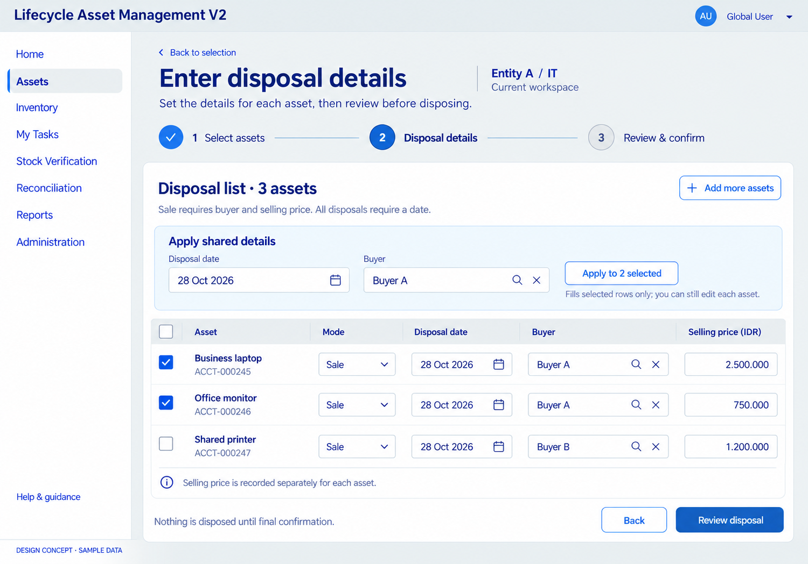
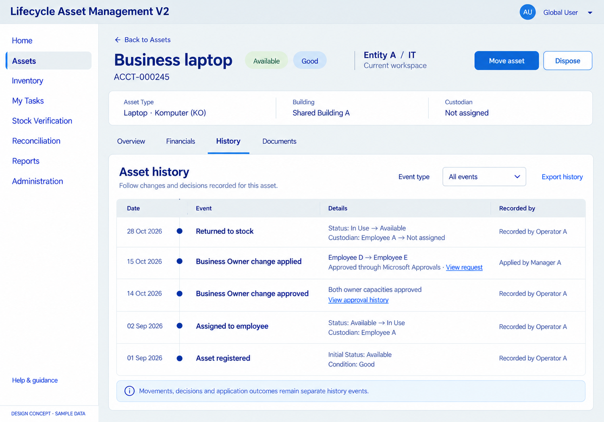

# Disposal workspace and Asset Details/History concepts

Date: 2026-10-28. Status: agreed working visual designs under D065 (owner confirmation 2026-10-28); not implemented screens. Both use sample data and the approved palette/spacing direction. Visual acceptance does not settle every interaction or implied sample control; remaining business/implementation gates are recorded below and in D065.

## Disposal workspace

[Open full image](01-disposal-workspace.png)

Reflects D062–D064: single/multiple selected assets, per-asset disposal inputs, optional Apply to selected for shared date/buyer, and individual selling prices. The sample uses Sale on all three rows; it does not settle mixed Sale/Non-sale batch policy. Selecting rows identifies the shortcut's target subset; each row's disposal details remain independently reviewable. Final confirmation is still a later step, with no approval workflow.

Buyer representation/search, date restrictions, validation/error behavior, shared-value overwrite interaction and partial-failure handling remain subject to the implementation contract. The buyer input's illustrated affordance does not establish a company-directory source. See [direct disposal design](../../../../architecture/DIRECT-DISPOSAL-DESIGN.md).

## Asset Details and History

[Open full image](02-asset-details-history.png)

Proposes Overview, Financials, History and Documents tabs. The displayed History tab keeps current asset context above a chronological event list. Approval decisions and applied business changes appear as separate events, with links to authorized request context. Final history must preserve actual approver identities/service evidence, execution/recording identity, timestamps and prior/new values; sample actor labels are not instructions to manufacture or manually mark approvals.

Move asset and Dispose are optional single-asset entry points into the same action workspaces. They do not replace the selected-assets movement/disposal paths. Actual controls, exports and history links follow the viewer's authorization. Asset Tag format remains deferred; the sample identifies the asset using its Accounting Asset Code. Financial formula/initial Book Value remains deferred despite the proposed Financials tab.

## Generation

Built-in image generation, one image per screen, using the movement workspace as style reference. Exact instructions are in [PROMPTS.md](PROMPTS.md). Original outputs retained and local copies saved in the delivery workspace. These raster concepts are not Power Apps resources; production uses approved ZDS/logo assets and requires interaction/accessibility checks. Runtime status: NOT RUN.
