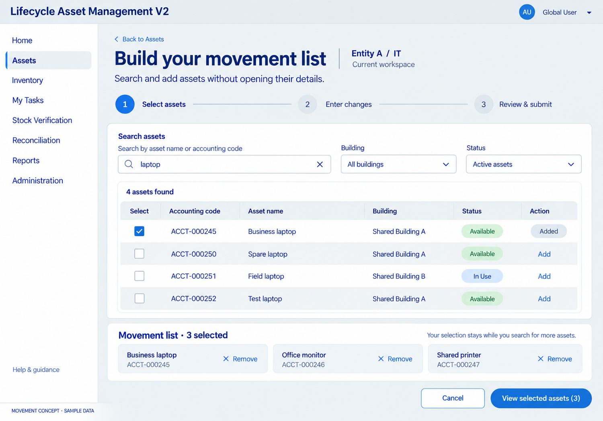
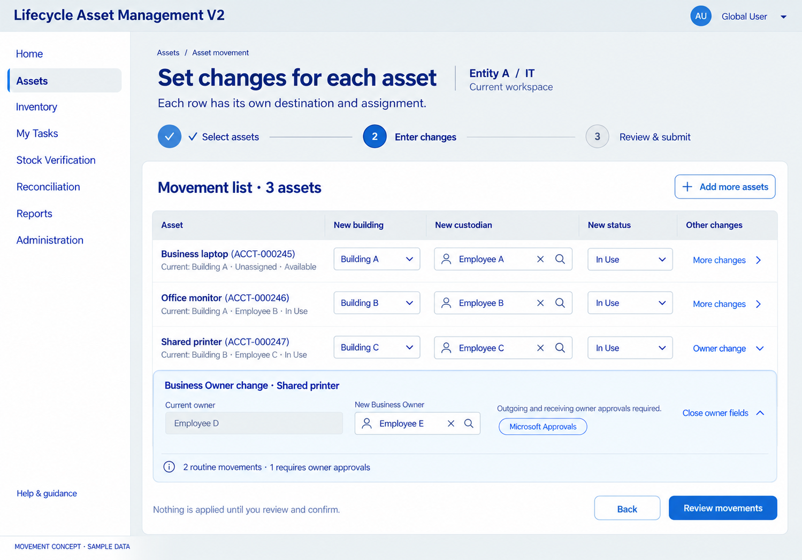
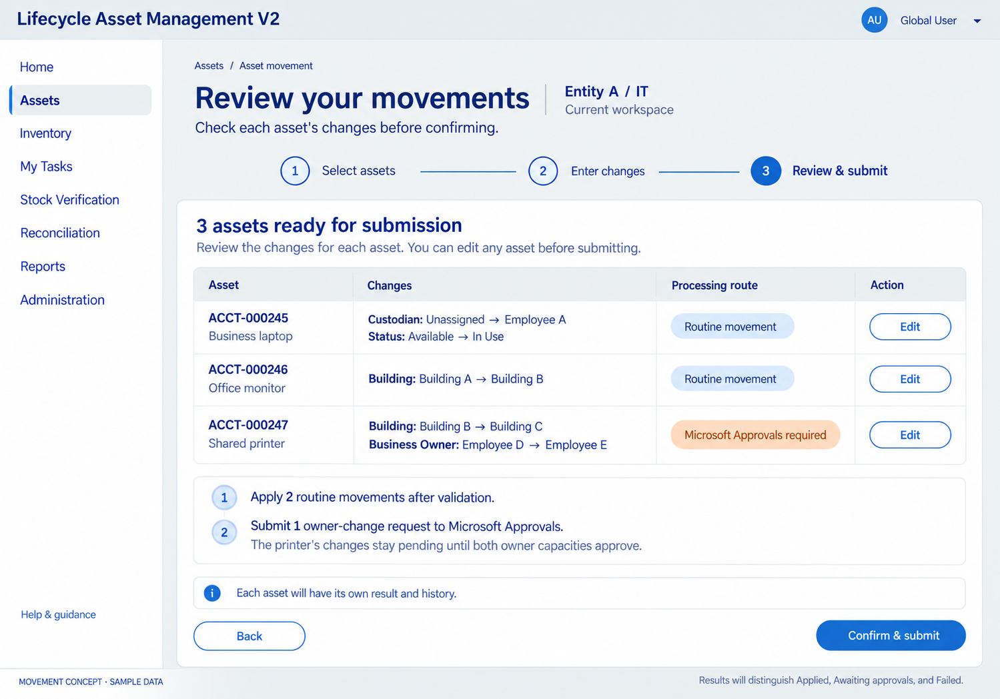

# Asset movement — proposed design flow

Date: 2026-10-28. Status: visual proposals with sample data; no app/list/flow changes or runtime tests. The owner confirmed selected-list entry (D059) and different changes per asset (D060). The screen sequence and mixed-route execution details below are proposals for review.

1. **Select assets:** search and add without visiting individual details. Keep prior selections through further searches. View selected assets opens the list as a whole.
2. **Enter changes:** each asset has its own building/custodian/status fields. Expand owner/scope/type changes inline when relevant; do not navigate to separate asset detail pages.
3. **Review and submit:** show prior/new values and processing route for every asset before confirmation. The example has two routine rows and one owner-change row. No mandatory BAU reason is introduced.
4. **Track individual results:** show applied versus awaiting approvals versus failed outcomes. Microsoft approval outcomes and actual transfer application remain separate. Partial-failure policy/grouping need final review; the concept is not a whole-batch atomicity guarantee.

The sample printer changes both building and Business Owner. The proposed review holds that asset's combined changes pending the required owner capacities rather than applying part of its reviewed transaction immediately. Same-person capacities still require one explicit response; rejected requests leave assets unchanged. Cross-entity types still follow D057.

[Detailed movement design and Mermaid flow](../../../../architecture/ASSET-MOVEMENT-WORKSPACE.md) · [Generation prompts](PROMPTS.md)

## 1. Search and add

## 2. Different changes per asset

## 3. Review the proposed processing routes

Built-in image generation was used, with the previous Assets register concept as style reference. Navy/Zurich Blue/white/Dove palette follows the supplied baseline guidelines. Final production components, approved brand assets, interactions and authorization need separate implementation/validation. These raster previews are not Power Apps source files.
