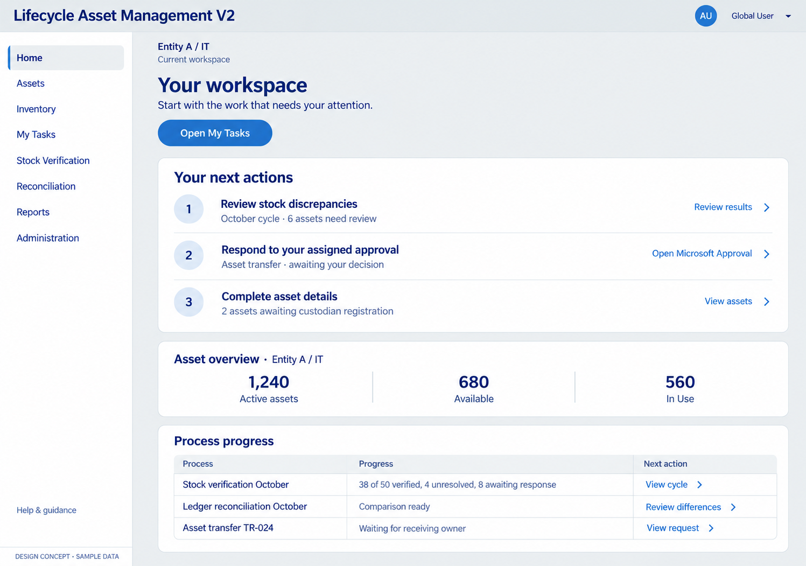
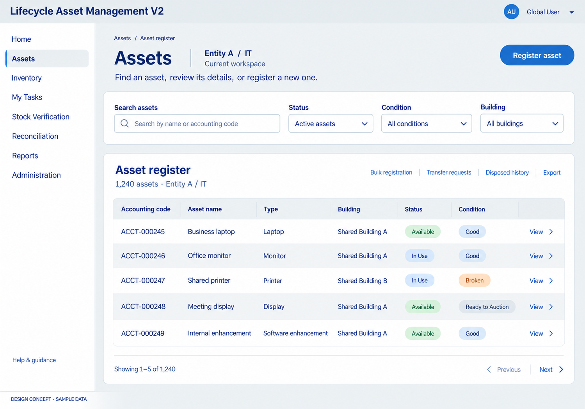
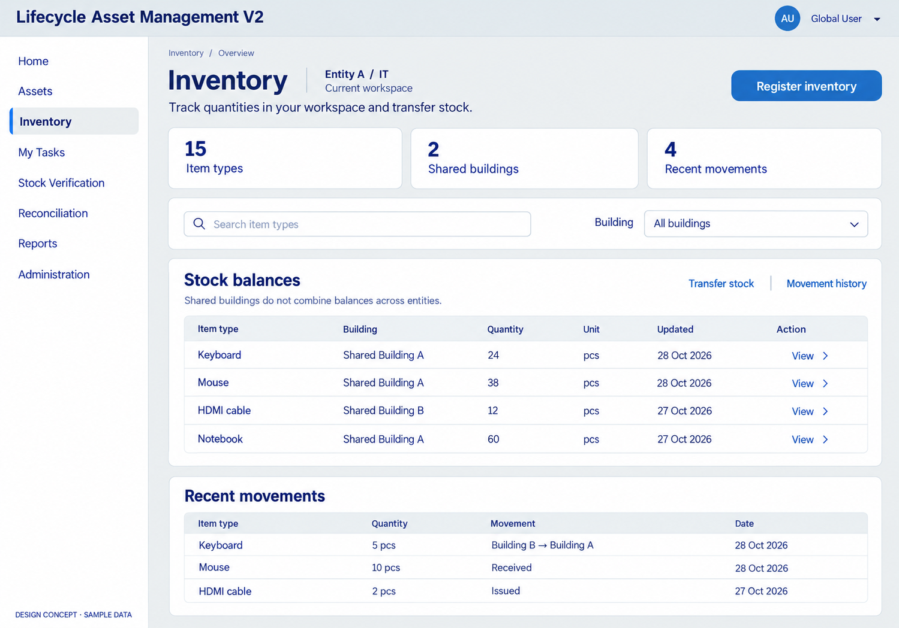
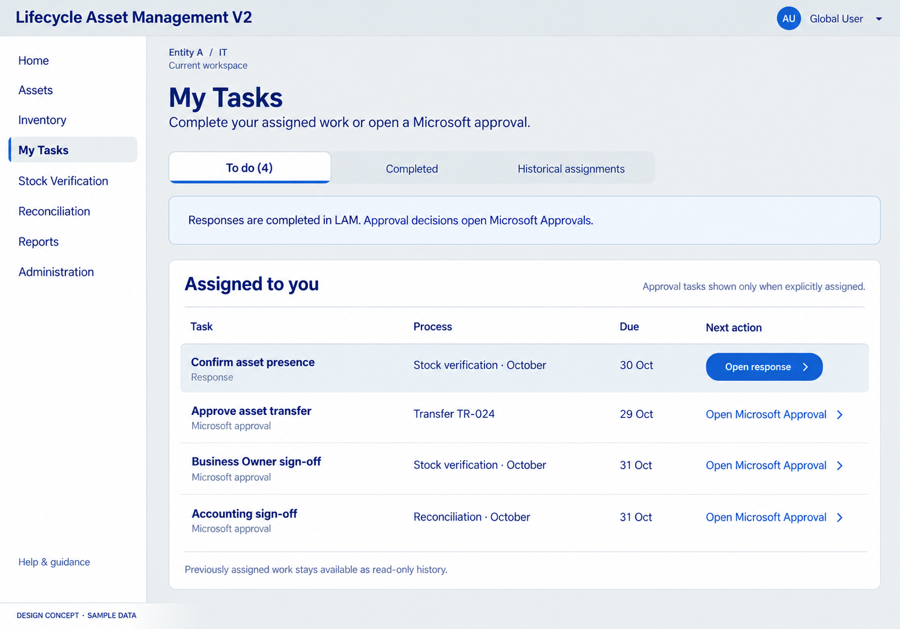
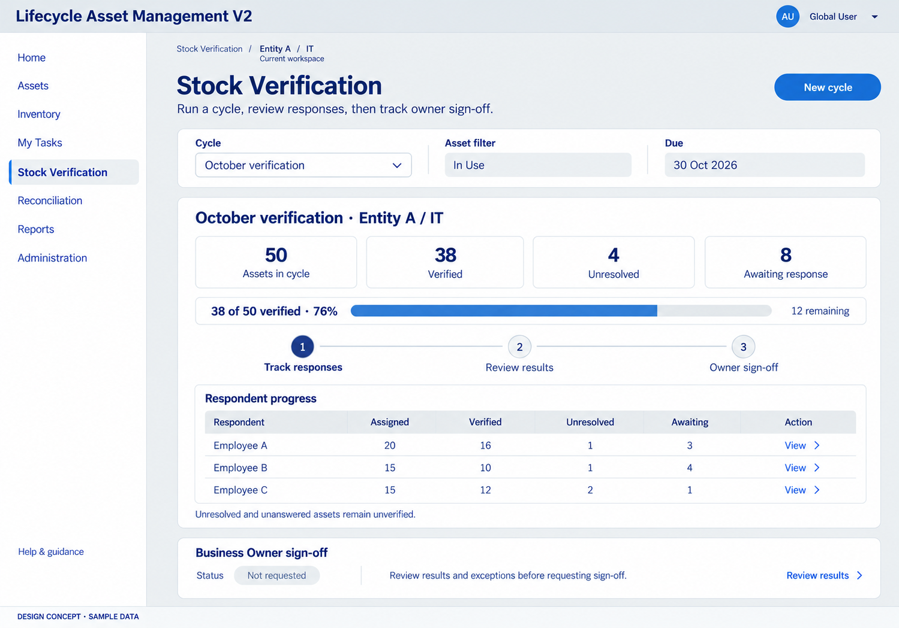
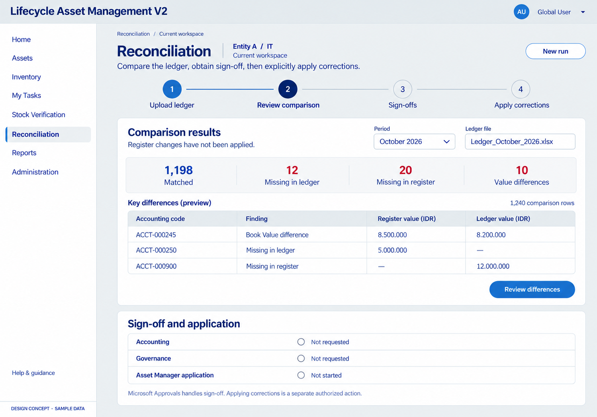
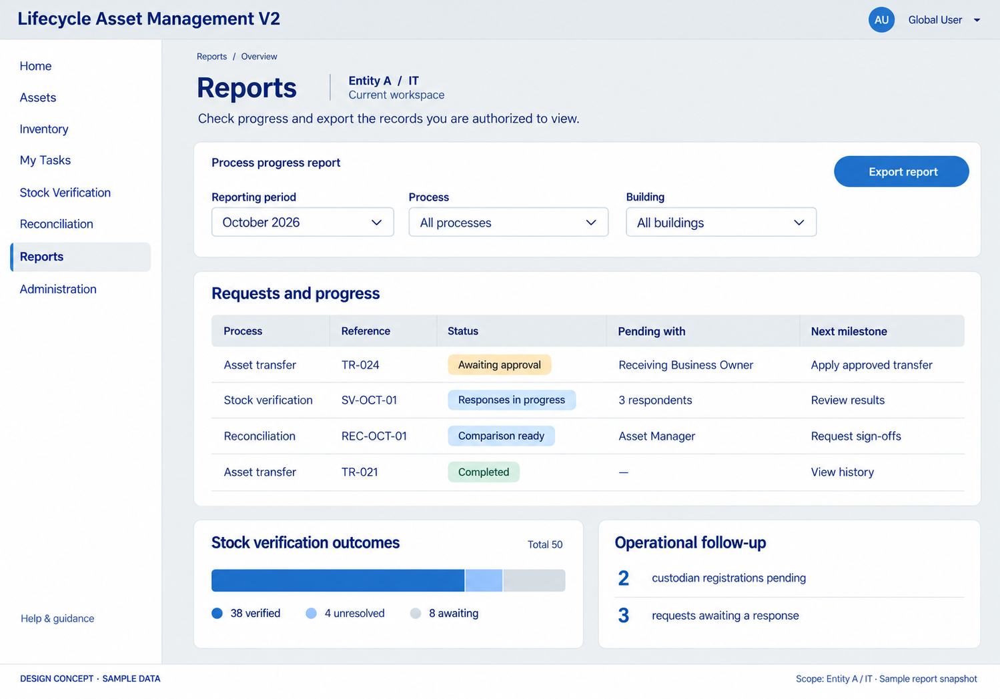
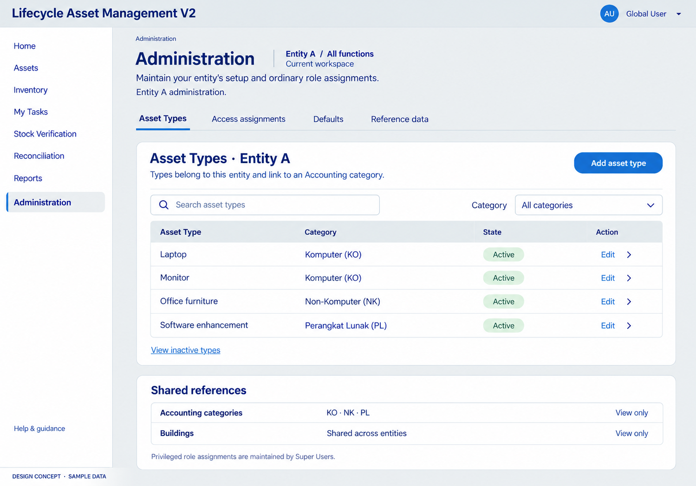

# Main screen concepts — 28 October 2026

Status: proposed visual concepts for owner review, not implemented screens or approved detailed workflow contracts. The owner accepted the palette/spacing of Concept 01 and requested a clearer guided reading path; the guided registration Concept 02 is the shared style reference. These main screens extend that direction for review.

All data, names, amounts, task counts and reference codes are illustrative. These examples show a Global User; actual navigation and operations follow implemented grants and explicit task/approval assignments. Detailed states, controls and interactions remain subject to review. Microsoft Approvals handles approval decisions; LAM retains evidence tasks and progress/history.

| Screen | Preview |
| --- | --- |
| Home | [Open concept](01-home.png) |
| Assets | [Open concept](02-assets.png) |
| Inventory | [Open concept](03-inventory.png) |
| My Tasks | [Open concept](04-my-tasks.png) |
| Stock Verification | [Open concept](05-stock-verification.png) |
| Reconciliation | [Open concept](06-reconciliation.png) |
| Reports | [Open concept](07-reports.png) |
| Administration | [Open concept](08-administration.png) |

## Review order

Start with Home's action hierarchy, then Assets/Inventory table readability and My Tasks' distinction between LAM responses and Microsoft approvals. Review Stock Verification/Reconciliation stage clarity, Reports' progress view and Administration's entity-scoped catalogue. Layout examples do not establish company runtime outcomes.

## Visual direction

Zurich Dark Blue #23366F text, Zurich Blue #2167AE primary actions, Zurich White #ECEEEF background, white cards, Dove #DDE4E3 borders and Dove-80 #E4E9EC header. Arial-like typography, restrained rounding, larger labels and a clear top-to-bottom hierarchy. Brand source: [Zurich guidelines](../../../../reference/Zurich%20Brand%20Guidelines.md). Final production work requires approved original logo/ZDS assets and interaction/accessibility validation; generated raster previews are not final Power Apps resources.

## Generation record

Generated using the built-in image-generation tool, one image per screen. [PROMPTS.md](PROMPTS.md) records the generation instructions and style reference. Original images retained; local copies saved in the repository delivery workspace. No app/list/flow changes or runtime tests were performed.

## Home

## Assets

## Inventory

## My Tasks

## Stock Verification

## Reconciliation

## Reports

## Administration

