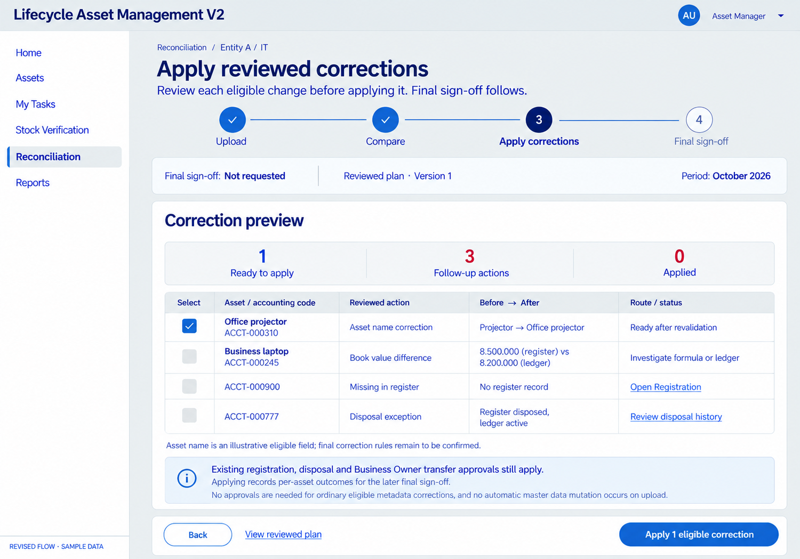
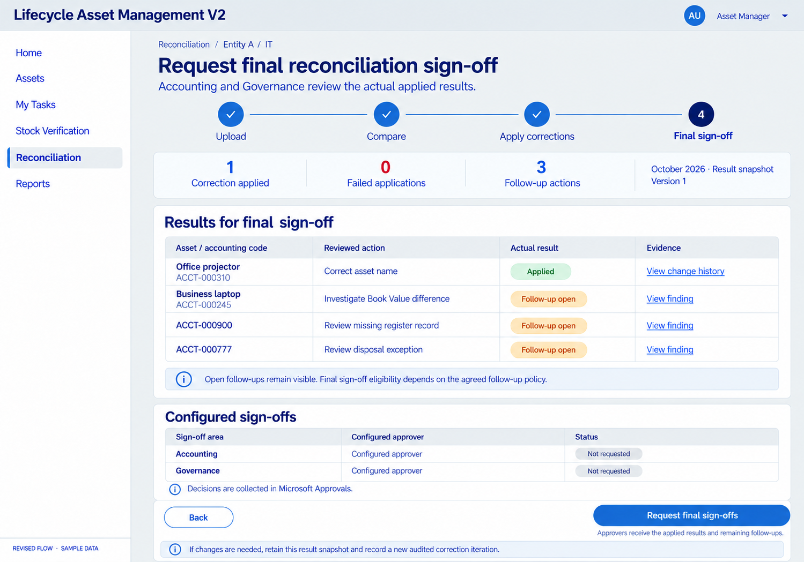

# Reconciliation — apply before final sign-off

Status: D070 confirms this ordering. Screen details remain proposals; no company implementation or runtime test is claimed.

Upload → Compare/review → Authorized Asset Manager previews and explicitly applies eligible corrections → Accounting/Governance final sign-off on actual applied results through Microsoft Approvals.

Keep the required Business Owner approvals before their specific owner/scope transfers. Application outcomes and final certification are separate. Missing register records route to registration; disposed exceptions retain history; Book Value follows the deferred monthly formula with no automatic ledger overwrite.

Final rejection/rework/rollback handling, sign-off eligibility with unresolved follow-ups, eligible correction fields and ordering between Accounting/Governance remain open. Button states, Asset Name correction, sample counts and result-snapshot labels are illustrative.

[Canonical design](../../../../architecture/RECONCILIATION-DESIGN.md) · [Decision D070](../../../../decisions/DECISIONS.md) · [Exact generation prompts](PROMPTS.md)

Earlier [approval-first visual sequence](../reconciliation-flow/README.md) is retained as historical design evidence, superseded for ordering.

