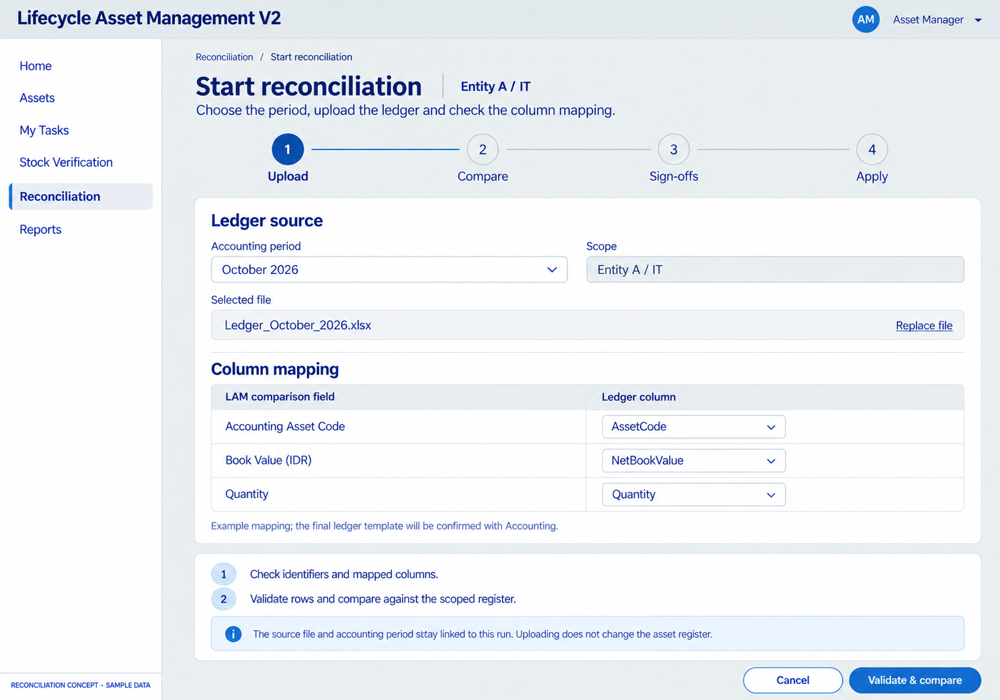
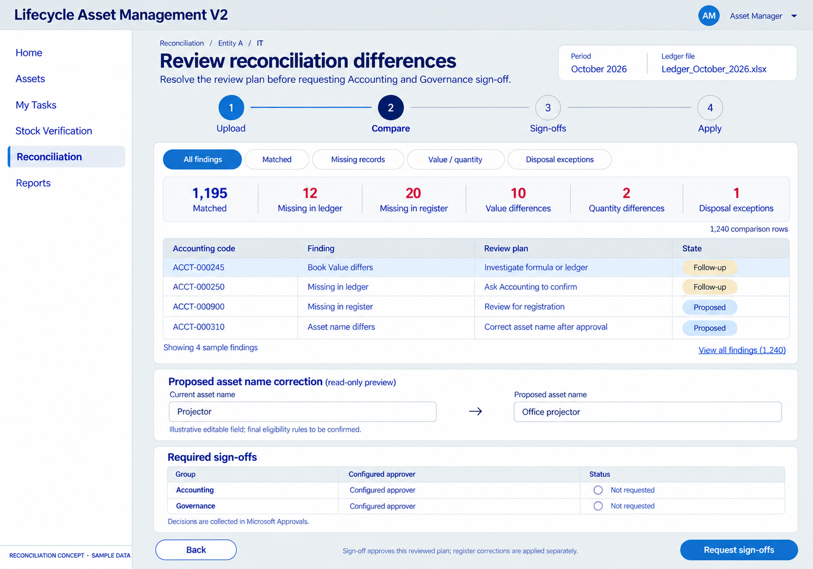
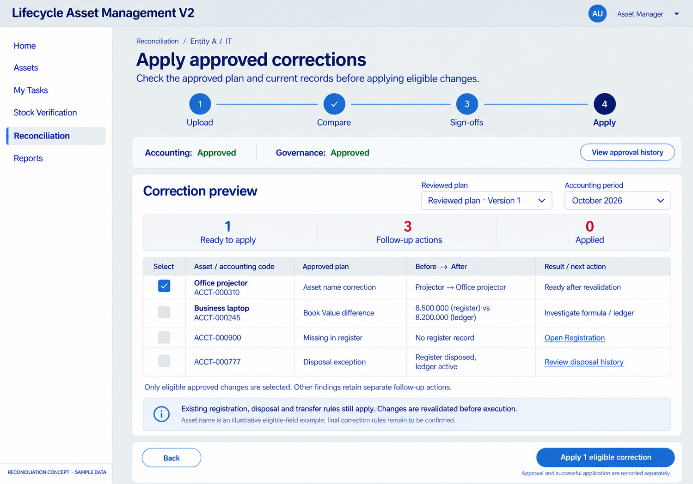

# Reconciliation — proposed visual flow

Reconciliation ordering update — D070: the earlier reconciliation images are historical. Use the [revised apply-first visual sequence](../reconciliation-apply-first/README.md): review → explicit authorized apply → Accounting/Governance final sign-off on actual results. Original images and prompts are retained as design history.

Date: 2026-10-28. Status: detailed visual/interaction proposal; existing D036–D038/D042/D046 rules remain in force. No company app/list/flow changes or runtime results.

## 1. Upload and validate

Choose period, retain the source file reference and inspect mapping. Source field names/file type are examples; Accounting's actual template is not yet supplied. Uploading does not change master data.

## 2. Review differences and request sign-offs

Review findings and the proposed plan. Accounting/Governance decisions use Microsoft Approvals. The plan's readiness policy for unresolved follow-ups, routing order and exact comparison categories are not settled by the pictured controls.

## 3. Explicitly apply eligible approved corrections

Revalidate the approved plan/current record state before application. Asset name is an illustrative eligible-field example, not a finalized mutation permission. Book Value remains formula-driven, with differences investigated. Missing/disposed records route to their existing authorized processes rather than automatic creation/reactivation.

The sample counters, values and actor labels are illustrative. Final aggregation must distinguish assets, ledger rows and potentially overlapping findings. Final file schema, correction allow-list, partial failure/recovery and financial formula/override rules remain open.

[Detailed proposal](../../../../architecture/RECONCILIATION-DESIGN.md) · [Monthly Book Value requirement](../../../../architecture/MONTHLY-BOOK-VALUE-DESIGN.md) · [Generation prompts](PROMPTS.md)

Built-in image generation, one image per screen; earlier Reconciliation overview used as style reference. Original outputs retained and local copies saved in the delivery workspace. Production requires approved brand components/assets, interaction/accessibility checks and backend implementation. Runtime status: NOT RUN.
