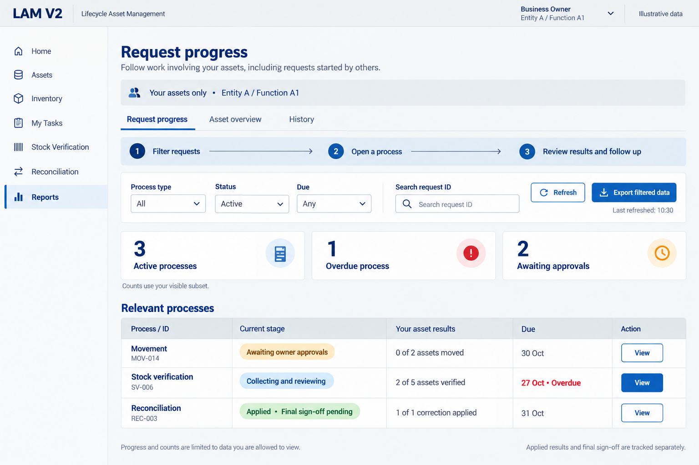
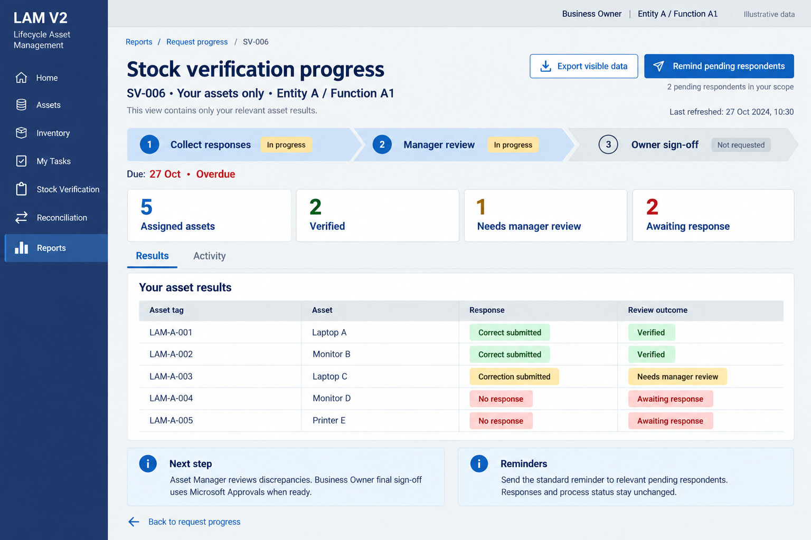

# Reporting and request progress — visual proposal

Status: flow and visual direction accepted as the working design under D071, extending the accepted palette and confirmed reporting/export/reminder scope. Detailed controls and open contracts remain proposals. No implementation or runtime test is claimed.

Reports → Request progress → Open a relevant process → Review outcomes and activity → Export authorized data or send an eligible standard reminder to pending respondents.

## 1. Request progress

Business Owner sees relevant owned-asset work, including requests started by others. The three active processes include one overdue process and two awaiting approvals; cards overlap and count processes, not recipients. Reconciliation shows applied results before final sign-off.

## 2. Scoped stock-verification detail

Five visible assets: two verified, one needing manager review and two awaiting response. Correct submitted is not automatically verified. Reminders target relevant pending respondents without changing responses or business status. Owner sign-off uses Microsoft Approvals when eligible.

All names, tags, dates, counts and statuses are illustrative. Due-date rules, metrics, export formats, reminder delivery and production state names remain open. The example is a Business Owner view; other roles follow their actual grants/assignments. No unrelated owner/entity data is exposed by this concept. Final implementation needs backend authorization and real brand/accessibility validation.

[Detailed design and open gates](../../../../architecture/REPORTING-PROGRESS-DESIGN.md) · [Generation prompts](PROMPTS.md) · [Brand reference](../../../../reference/Zurich%20Brand%20Guidelines.md)

Original generated images are retained as proposal evidence. These mockups are not deployable Power Apps resources.

