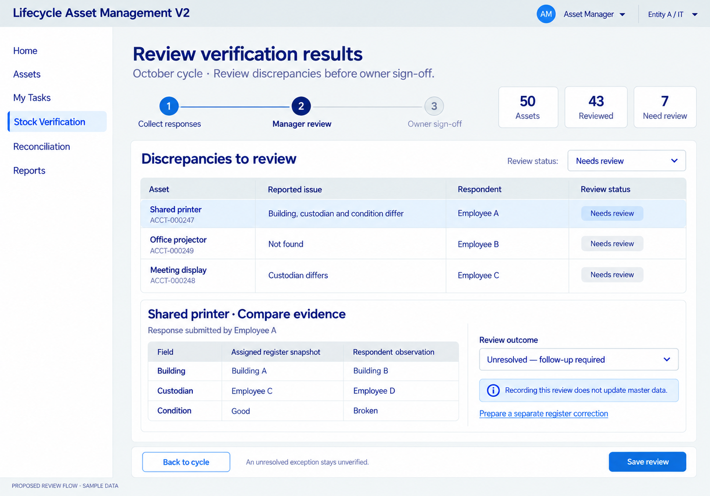
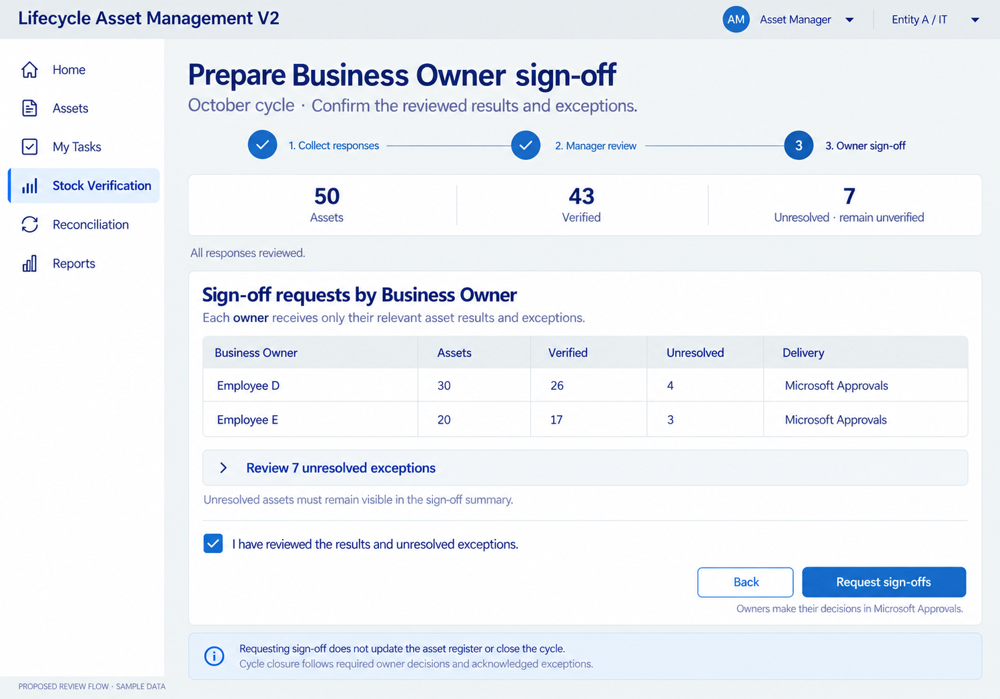

# Manager review and Business Owner sign-off — agreed working design

Date: 2026-10-28. Status: accepted working sequence and visual design under D069; no implemented app/flow or runtime results. Samples illustrate the next stages after the accepted respondent list experience.

## 1. Review evidence and record outcomes

Compare the assigned snapshot with respondent observations. Record a review outcome and preserve evidence. Master corrections use a separate authorized operation; the review action does not apply register changes. The sample unresolved result remains unverified.

## 2. Preview owner-specific sign-offs

Show reviewed results and unresolved exceptions, split by the relevant Business Owner. Microsoft Approvals receives the decisions. Requesting sign-offs does not close the cycle, verify exceptions or update master data.

The screenshots show successive sample stages: 43 reviewed/7 needing review, followed later by 43 verified/7 unresolved after review of all assets. Final verification criteria, controls, closure/rejection and acknowledgement rules remain to be designed. The illustrative checkbox and exact review labels are not new confirmed business rules.

[Detailed proposal](../../../../architecture/STOCK-VERIFICATION-REVIEW-DESIGN.md) · [Generation prompts](PROMPTS.md)

Generated with the built-in image-generation tool using the prior assigned-response correction concept as style reference. Original outputs retained; local copies saved with this delivery. Production uses approved ZDS assets and needs interaction/accessibility validation. All runtime checks NOT RUN.
