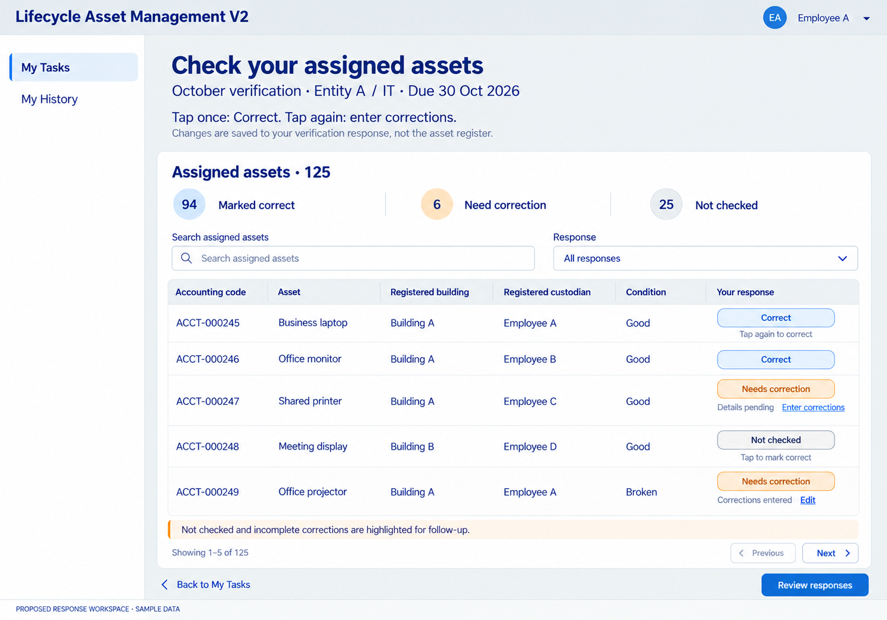
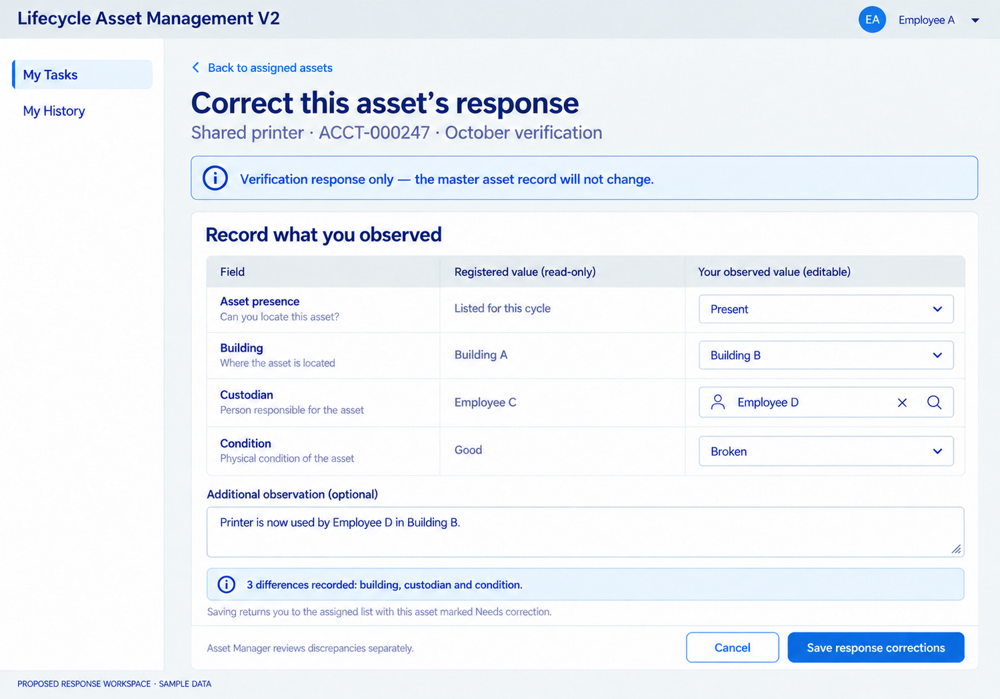

# Stock-verification respondent — revised list flow

Date: 2026-10-28. Status: list-first/correction-only direction confirmed D067 and visual concept accepted as a working direction under D068; exact components, save/cancel and submission mechanics remain proposals. Samples are illustrative; no company resources or runtime tests changed.

## 1. Check assigned assets in a list

First activation marks Correct. A second deliberate activation marks Needs correction and opens the correction screen; the proposed design does not depend on double-click timing. Display each row's response state and correction completeness. Marked correct is respondent evidence, not final manager verification.

## 2. Enter corrections only for mismatches

Save changed observations only to that assigned verification response, retaining the original assigned context. Return to the list without modifying master data. Presence is about locating/observing the asset, separate from the Available lifecycle status. The field set shown is illustrative and must be finalized before implementation.

## Boundaries

Only current assigned/open work is editable; historical/replaced assignments retain the agreed read-only view. No general register access or arbitrary asset-ID edits. No automatic master update or implicit ownership transfer. Manager review, Business Owner sign-off and unresolved-exception treatment stay separate.

[Detailed proposal](../../../../architecture/STOCK-RESPONDENT-LIST-DESIGN.md) · [Generation instructions](PROMPTS.md)

Generated using the built-in image-generation tool with the movement workspace as style reference. One targeted text edit clarified presence versus Available status. Original outputs retained; selected copies saved in the delivery workspace. These images are conceptual, not Power Apps source files.
