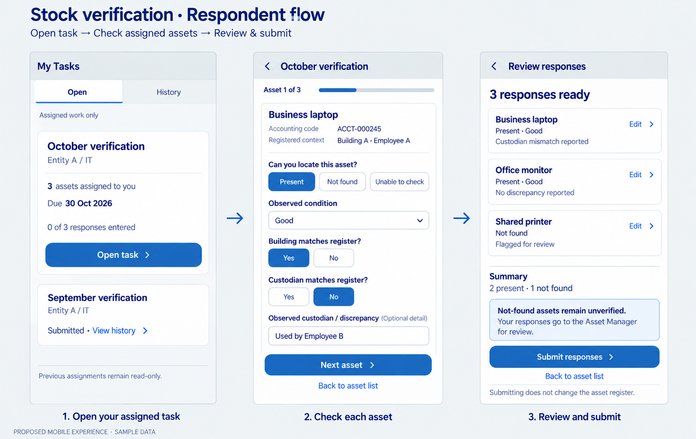

# Stock-verification respondent flow — earlier proposal

Date: 2026-10-28. Status: superseded as the primary interaction by D067's list-first response design. See [the revised list and correction screens](../stock-verification-respondent-list/README.md). Retained as historical proposal, not a confirmed response-field/state contract. No company app, list, flow or runtime test changed.

## Proposed sequence

1. Open a task from assigned work; prior assignments have a read-only history entry when closed.
2. Check each assigned asset using its registered context, record observed presence/condition and discrepancies.
3. Review the responses and submit evidence for Asset Manager review.

The illustrative presence choices Present / Not found / Unable to check, question wording, progressive per-asset layout, optional discrepancy detail and summary are proposals. Condition choices follow D053 (Good, Broken, Ready to Auction); Good in the screenshot is an entered sample observation, not an approved automatic prefill for evidence. Do not infer condition for an asset that was not observed.

Use only authorized assigned records; an assignment is not general register access. Registered building/custodian are context to compare against. Reported mismatches are evidence, not direct master updates. No verified outcome is inferred merely from submitting a response; not-found/unresolved assets remain visibly unverified and the separate manager/owner review rules continue.

Mobile screens illustrate one responsive experience, not a separately approved app. Support the same tasks on supported desktop/tablet devices. Exact persistence, draft/resume, requiredness, submission/edit-state transitions, manager review, owner sign-off, exception handling, accessibility and assigned-data export details follow in implementation contracts. D012's open-response versus closed-history access and audited reopening rules remain in force.

No photo requirement, device scanning, location floor/room, new permanent Respondent role or custom approval decision UI is introduced. Actors/data are samples.

## Generation record

Built-in image-generation tool, one three-screen storyboard, using the prior My Tasks concept as visual reference. [PROMPT.md](PROMPT.md) stores the exact generation instruction. Original output retained; copy saved in the delivery workspace. Runtime status: NOT RUN.
