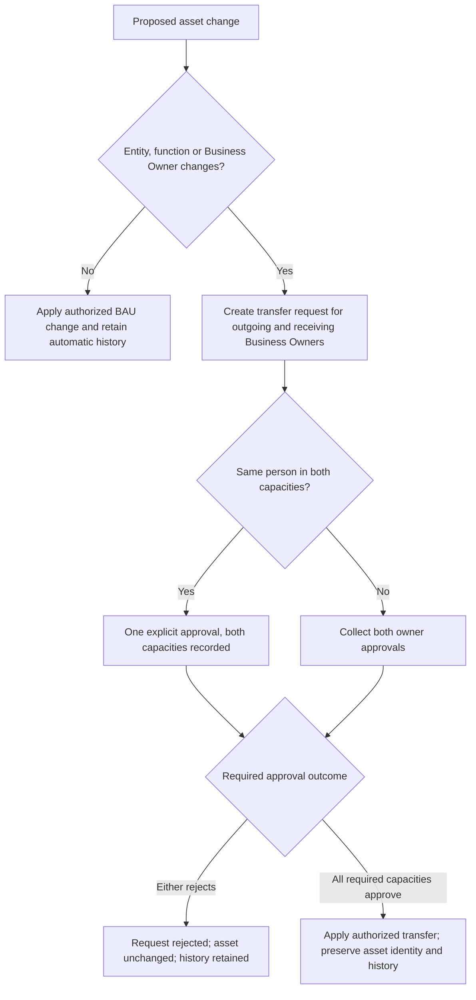
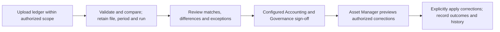

# Business process requirements — working draft

Status: registration/transfer/reason policies partly confirmed; further process decisions remain open. Confirmed role/scope requirements are in PERMISSION-MATRIX.md and ../decisions/DECISIONS.md. No new app/flow behavior is implemented by this document.

## Process coverage

1. Individually tracked asset registration (single and spreadsheet input), movement and direct disposal.
2. Quantity inventory registration and transfer.
3. Available/in-use stock verification, response, confirmation and relevant approvals.
4. Accounting reconciliation, discrepancy handling and relevant approvals.
5. Reporting, export, reminders and progress monitoring.

Separate disposal request/approval remains retired. Reopening/reassignment/history rules already confirmed are reused by relevant processes; their workflow-specific consequences still require design.

## Asset lifecycle: evidence already available

- Master_Asset supplies Asset_ID, organization/function, Accounting_Asset_Code, asset/business owner references, condition/status, location/type/category, dates, values and serial/device attributes.
- Asset_Movement_History references Asset_ID and stores movement-related state; audit records are separate. These are schema names, not proof of uniqueness, field types or complete historical integrity.
- Current implementation contains individual registration, a bulk parsing flow, movement form handling and direct disposal archive/audit/history/active-record removal. Static findings are documented in ../architecture/IMPLEMENTATION-FINDINGS.md.
- Preserve traceability of existing asset identities across migration and subsequent changes. Validate current identity quality rather than silently rewriting historical references. Whether accounting codes or serials may be duplicated is a business/data-contract question; neither is assumed to be the system key.

## Round 7 — confirmed asset process rules

| Decision | Confirmed behavior | Remaining design detail |
|---|---|---|
| D024 — bulk registration | Validate every row, preview results and let the operator confirm importing only valid rows. Keep invalid rows unimported with a downloadable error report. | Required fields, duplicate matching, import identifiers, row outcomes and safe retries after partial failure |
| D025 — cross-function/entity transfers | Both outgoing and receiving Business Owners approve; preserve asset identity/history and validate source/destination authority. Apply the transfer only after both approvals. | D027–D029 settle same-person/rejection/ownership-change rules; route order, concurrency/versioning and accounting consequences remain |
| D026 — routine transactions | No mandatory remarks/reason for BAU asset transactions; actor/time/old-new values are captured automatically. | Field-specific validation and automated event formats; reasons remain required for reopening/reassignment exceptions |

## Round 8 — confirmed transfer policies

| Decision | Confirmed behavior |
|---|---|
| D027 — same person is both owners | One explicit approval satisfies both recorded capacities; approval is not automatic. |
| D028 — rejection | Either required owner's rejection ends the request as rejected with the asset unchanged; a corrected request preserves prior request history. |
| D029 — Business Owner change | Approval by outgoing/receiving Business Owners is required even within one entity/function. Location/custodian/status changes leaving entity/function/Business Owner unchanged remain BAU under ordinary permissions. |

## Confirmed transfer overview

This is a business-flow overview, not a deployed flow or fixed canonical status vocabulary. Final transfer application must still validate authorization and current record state; approval success and application success are separate outcomes.

## Round 9 — confirmed registration, disposal and inventory rules

| Decision | Confirmed behavior | Remaining design detail |
|---|---|---|
| D030 — registration versus update | Create new assets only. Report identified duplicates without overwriting existing records; changes use authorized edit/movement processes. | Duplicate matching and stable import/retry identity |
| D031 — sale/non-sale disposal | Support sales and non-sale retirement. Disposal date required; buyer/selling-price details apply to sales. No mandatory BAU remarks/justification. | Method labels and any applicable reference/document fields |
| D032 — quantity-inventory transfers | Lightweight authorized transfers, without asset-style dual Business Owner approval. Retain quantity/scope checks and movement history. | Cross-scope action authorization, quantity units/validation and concurrent balance updates; no inventory owner relationship added solely for the rejected approval route |

The dual Business Owner approval rules D025/D027/D028/D029 govern individually tracked assets; D032 explicitly prevents carrying that route into quantity inventory by analogy.

## Stock verification — round 10 confirmed

| Decision | Confirmed behavior | Detail for design/review |
|---|---|---|
| D033 | Scope derives from access matrix/authorized session; Available/In Use filters the asset set; due date has a configurable default. | Target permission-source schema, default duration/configuration ownership and reviewable respondent prefills. Preserve existing authorized-session selection when more than one pair is available. |
| D034 | Respondents report presence/condition/ownership/location discrepancies; Asset Manager reviews differences. | Verification evidence does not silently alter master records; corrections use existing authorized update/transfer processes. |
| D035 | Business Owners sign off relevant asset results; close only with a verified result or explicit acknowledged unresolved exception per asset. | Unanswered/unresolved assets remain unverified, with exceptions visible in reporting after closure. |

Respondent task/history/export access, reminder authority, audited reopening and participant reassignment continue to apply. Available and In Use are asset-set filters; a unified interface does not imply identical verification evidence or matching rules. Exact status vocabulary remains a design contract.

## Accounting reconciliation — round 11 confirmed

The source contains accounting and IT Governance summaries and an approval-request flow; actual target approvers/configuration must be verified in the company environment.

| Decision | Confirmed behavior | Remaining design/review detail |
|---|---|---|
| D036 | Review matches, records missing on either side, value/quantity differences and disposal exceptions before register changes; retain period/file/run provenance. | Baseline matching/grouping validation, field semantics and input schema. |
| D037 | Configured Accounting and Governance approvers sign off for the relevant entity/function through explicit task assignments, without adding permanent application roles. | Routing order, configuration source, substitutions and exact task-level access. |
| D038 | Authorized Asset Manager previews and explicitly applies proposed corrections after sign-off, with audit. Comparison does not automatically create/dispose assets or alter ownership/scope. | Correction eligibility, affected fields, partial failures and retry/concurrency behavior; existing action/approval rules remain applicable. |

### Reconciliation overview

The diagram shows the successful business path; it does not prescribe sequential approval order or omit the need for rejected/failed/cancelled states in implementation. Successful approval does not imply every proposed correction has been applied. Registration/disposal/transfer rules still govern those actions.

## Requirement-level acceptance examples for confirmed rules

- A spreadsheet containing valid and invalid rows is fully validated before confirmation. Only explicitly confirmed valid rows are attempted; invalid rows appear in an error report and never silently become assets.
- A cross-function/entity transfer is not applied with only one required approval or before both eligible Business Owners approve. Unauthorized requests cannot bypass this through a direct flow call.
- When the same eligible person is both owners, one explicit decision is recorded for both capacities; merely holding those capacities does not auto-approve.
- Either required owner rejecting leaves the asset unchanged and retains rejected-request history. A Business Owner change within one entity/function follows the same approval requirement.
- Successful transfer preserves the asset identity and source/destination history. Request approval is not reported as completed asset movement if applying the change fails.
- Registration never silently overwrites an identified existing asset; valid new rows remain eligible for confirmed import and duplicates appear in the results report.
- A non-sale disposal does not require a fictional buyer/selling price; sales use the applicable sale fields and every disposal has a disposal date.
- An authorized inventory transfer does not create a dual Business Owner approval task. It still validates scope/quantity and records movement history.
- BAU asset changes save without entering remarks/reason. Automated change history still records actor/time/old-new values. Reopening/reassignment without the required exceptional reason remains rejected.

## Stock verification acceptance examples

- A user cannot create a cycle for an entity/function outside its access-matrix/session authority; filters do not broaden that authority.
- Available/In Use selection restricts the cycle asset set; due date uses the configured default rather than a hardcoded campaign date.
- Respondent discrepancies are retained for review and do not silently alter the master owner/location/scope.
- Closed cycles with acknowledged exceptions still report missing/unresolved assets as unverified; completeness and verification success are distinct measures.

## Reconciliation acceptance examples

- Upload/comparison leaves operational master records unchanged and preserves the source period/file/run reference.
- Configured eligible Accounting/Governance participants can decide assigned steps; unrelated users cannot access or approve the run.
- No correction is applied before required sign-off and explicit authorized Asset Manager action.
- A correction changing Business Owner or scope still requires the applicable transfer approval; reconciliation sign-off does not bypass it.
- Applied/rejected/failed correction outcomes remain distinguishable with audit/history and recovery evidence.

## Remaining registration design detail

Required fields by asset type, accounting-code uniqueness scope, serial-number applicability, initial statuses, owner/location defaults, record validation, exact duplicate matching and safe bulk retry behavior. Business choices D024/D030 are already confirmed. Existing YAML provides evidence for review but does not automatically approve every current rule as the V2 requirement.

## Remaining process work

The main accounting reconciliation behavior is confirmed in D036–D038. Finish acceptance/rollout constraints, then consolidate field/routing details and technical assumptions for review. Stock-verification rules D033–D035 are confirmed; remaining evidence/prefill/configuration details are reviewed as labeled design assumptions. Carry registration/disposal field details and technical validation into a consolidated review draft, clearly distinguishing confirmed decisions, baseline evidence and engineering assumptions. Keep company-side facts separate from owner business decisions. Define retention and operational acceptance targets from company requirements rather than assumptions.
