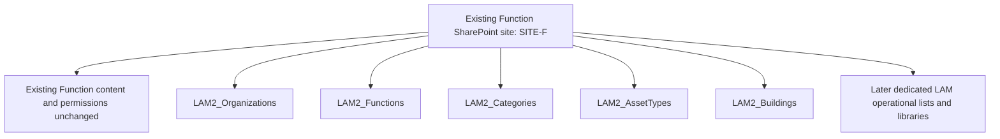

# Hosting LAM on the existing Function site

Status: owner direction D073, 2026-10-30. The planned dedicated site is unavailable. Use the existing Function site, aliased SITE-F in these guides, with dedicated LAM lists/libraries inside it. SITE-A refers only to the earlier unavailable dedicated-site plan. No site configuration or data migration has been performed.

## Recommended structure

Keep the existing names and field contracts. Lists are separate site resources; a LAM folder in the site's existing Documents library is not a container for these lists or a replacement for their permissions. A navigation heading may group links for convenience, but does not provide access control.

The site is hosting infrastructure, not the business data's Entity/Function owner. LAM still uses Organization → Function scope, entity-specific types, shared buildings and the accepted roles across all relevant entities. Do not force every asset into the hosting Function or add host-site membership as an application role.

## Set up the first five lists

1. In SITE-F, create only the new dedicated LAM lists. Follow [Organizations/Functions](CREATION-GUIDE.md) first, then [Categories/Asset Types/Buildings](reference-foundation-002/README.md). Keep the exact `LAM2_` names. Do not rename or repurpose unrelated Function-site lists.
2. On each new LAM list, use List settings → Permissions for this list → Stop Inheriting Permissions, where available to the authorized maintainer. Do this while the list is empty, before seed or business data is added.
3. Review the copied permission entries. Stopping inheritance alone does not remove copied broad access. On that LAM list's permission page only, remove broad host Members/Visitors or other entries that are not intended LAM readers/maintainers. Preserve approved administrative/setup access so the list remains manageable.
4. Grant the LAM-specific groups/identities below only on the appropriate LAM resources. Do not delete a host-site group, remove its site membership, change the whole site's inheritance or restrict unrelated lists/libraries.
5. Apply the unchanged optional business-column, unique-key, lookup and versioning contracts. Keep all related lists together in SITE-F so the lookup relationships remain local to that site. After permissions are configured, seed only the confirmed KO/NK/PL Category rows under the controlled setup guide.
6. Bind Power Apps to SITE-F and the delivered reference list names when implementing. Keep SharePoint site URL/list/library bindings in configuration; do not embed the Function's name into asset identity, organization codes or role logic. ENV-A does not change solely because the SharePoint host changes.

Microsoft documents that lists inherit permissions by default and supports list/library-specific permissions after inheritance is broken. The owner must inspect/correct the copied entries on the new resource. [Permission customization](https://support.microsoft.com/en-us/sharepoint/lists/sharepoint-sharing-and-permissions/customize-permissions-for-a-sharepoint-list-or-library). Lookup relationships should be created within the same site. [Lookup guidance](https://support.microsoft.com/en-us/sharepoint/lists/data-and-lists/create-list-relationships-by-using-lookup-columns).

If the needed permission controls are unavailable to the current user, the existing site's authorized owner/administrator handles those specific LAM-resource changes. That does not require changing the architecture or another general capability questionnaire. Existing permissions reported for the old site are not assumed to apply to SITE-F.

## Proposed technical access groups

These names describe responsibilities; actual company groups/identities are configured by the owner. They are not additional application roles.

| Responsibility | Access on LAM resources | Boundary |
| --- | --- | --- |
| LAM setup maintainers | Required schema/permission administration on the new LAM lists/libraries during setup | Controlled technical maintainers; do not give all app users schema/permission rights |
| LAM reference readers | Read on the reference catalogues intentionally made available to them | No grant to assets, access grants, responses, history or the site's unrelated content |
| LAM operational connection identity | Only the list/library read/write capabilities required by delivered operations | Connection authority is distinct from the authenticated end-user's allowed operation |
| End users / task participants | App and explicitly authorized rows/fields/tasks/reports under the selected backend design | Do not give broad operational-list Edit to make the app work |

Direct read access to an Asset Types list permits the rows allowed by its SharePoint permissions, independently of the app's entity filter. If the company requires finer catalogue confidentiality, use the documented mediated/scoped adapter before release. A read group is not a substitute for row/field enforcement on sensitive operational data.

People from other entities/functions do not need broad membership in the host Function's site merely to access specifically shared LAM resources. SharePoint can provide Limited Access to required parent locations without granting unrelated content access. [Microsoft permission levels](https://learn.microsoft.com/en-us/sharepoint/understanding-permission-levels). Actual access depends on the company's site/tenant policies and configuration.

Site/tenant administrative authority remains outside LAM's business-role matrix. List-level separation does not promise isolation from platform administrators or independence from host-site retention/lifecycle policies. The host site's ownership, classification and retention must be suitable for the cross-entity LAM data stored there; if they are incompatible, the owner resolves that specific hosting constraint before loading affected business data.

## Later operational data and files

Continue using new dedicated `LAM2_` resources, rather than reusing the Function's existing lists. Decide each operational list's authorization with its delivered read/write contracts; list-level inheritance separation prevents broad parent access but does not by itself implement entity/function/owner/assignment row restrictions.

For files, propose dedicated LAM libraries such as `LAM2_Uploads`, `LAM2_Evidence` and `LAM2_Exports` when those features are delivered. These are planned responsibilities, not creation-ready library definitions. Avoid storing confidential LAM files in a broadly readable existing Documents folder. Separate source/evidence/export access and retention where needed; a library or folder name alone is not security, and exports still require authorized download scope.

The shared-site plan does not add one permission scope per asset, broaden Global User into a site administrator, change Super User into a tenant administrator, or remove the accepted operational authorization checks.

## If some LAM lists already exist elsewhere

Do not delete or recreate them automatically. If they are empty and unused, adapt the existing creation guides to SITE-F after preserving any settings that matter. If they contain data or are connected, retain a source/target mapping and migrate with reviewed validation before switching app/flow bindings. SharePoint numeric item IDs, lookup references, list IDs and file URLs can change; changing only a site URL is not a complete migration plan. Keep the source until cutover and rollback evidence is accepted.

No lists or data are assumed to exist from the earlier plan. This branch is recovery guidance, not a claim that a migration is required.

## Your immediate starting point

Create the five LAM reference lists on the existing Function site, isolate their permissions at list level, then follow the unchanged field/seed guides. No subsite, new tenant service, site-wide redesign or replacement of existing Function content is required by this plan. Configure actual access/connectors while implementing, as requested under D072; no report is required merely to continue design.
