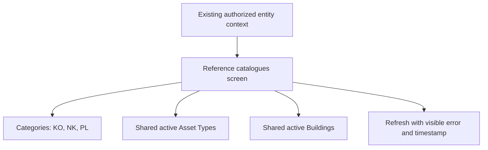

# Reference catalogues — first manual app resource package

Status: implementation resources prepared; not compiled, deployed or runtime-tested. This package is for the owner's new blank LAM V2 app, not the preserved baseline YAML app. It uses an existing blank Screen1, three read-only catalogue tabs and the accepted Zurich palette. No operational asset data or maintenance writer is connected.

## Package contents

- [MANIFEST.json](MANIFEST.json): exact controls, source aliases, context input and status.
- [CONTROL-PROPERTIES.csv](CONTROL-PROPERTIES.csv): control names, parent relationships via the manifest, layout/text/style formulas and formula-file references.
- [formulas](formulas): six manual formula-bar resources for initialization, errors, refresh and the three gallery queries.
- [TEST-CASES.csv](TEST-CASES.csv): feature-specific manual checks; all NOT RUN, separate from the existing 78-case baseline/target kit.
- [Physical list setup](../../../../Others/sharepoint/v2/reference-foundation-002/README.md): three reference lists and fixed Category seed data.

These are manual Studio resources, not a .msapp, solution ZIP, control YAML snippet or an applied app. There is no active Canvas Authoring session on the company device available here, so no compilation or live edits are claimed.

## Screen and data flow

This is a limited implementation of reference browsing, not the complete Administration module or role/session resolution. It has no Add/Edit/Delete/Approve action. Asset Type maintenance is shared-catalogue maintenance by Global Users and Super Users under D074 and needs its later controlled writer; the reader does not grant that authority.

## Implement manually when ready

1. Save the current app version and any existing Screen1/App formulas. Work in the intended new V2 app. If Screen1 now contains useful controls or logic, preserve it and adapt this package into a separate reviewed screen rather than replacing it blindly.
2. Prepare the three lists using the physical guide. At implementation time add only LAM2_Categories, LAM2_AssetTypes and LAM2_Buildings as SharePoint data sources, with those exact aliases. List permissions remain the source's authority; an app filter does not restrict copied list URLs.
3. Merge [App.OnStart additions](formulas/App.OnStart.additions.powerfx) into the app's initialization. It sets brand values, tab/error state and an unresolved default context. Do not overwrite unrelated existing startup/session behavior. Run OnStart in Studio after the merge.
4. Merge [App.OnError additions](formulas/App.OnError.additions.powerfx) with the existing error handler. It exposes a safe message and ends the busy display; it does not reveal raw connector details. This handler is package-specific and should be integrated into the eventual app-wide error component.
5. Keep Screen1 as the existing start screen for this blank-app slice. Insert the classic Label/Button and blank vertical Gallery controls named in MANIFEST.json. Add row labels inside each gallery template, not as screen-level labels. Do not use a modern control with a different property contract and assume every formula maps unchanged.
6. Apply each CONTROL-PROPERTIES.csv row to the named control/property. Paste the Formula value, or the contents of FormulaFile where provided. Do not paste the CSV as YAML. Formulas use English comma argument separators and semicolon chaining; let Studio's locale determine equivalent syntax if different.
7. Bind `gblLAMReferenceContext` through the eventual authorized session adapter: OrganizationItemId is the numeric LAM2_Organizations.ID; OrganizationCode is the display code; IsResolved is the adapter's display state. Default zero/unresolved deliberately returns no rows and disables Refresh. Never replace it with First(Organizations), a freely selectable arbitrary numeric ID or a hardcoded production entity.
8. For a maker-only synthetic UAT later, a known approved Organization numeric ID/code can be used as a temporary context binding. Remove the temporary binding before promotion and test the real session/source-permission path. IsResolved is not caller authentication or a backend permission.
9. Check Studio formulas and App Checker. Confirm CategoryRef.Value matches the actual connector schema; this corresponds to the configured single Category lookup display value; the context OrganizationItemId remains an input for the wider session, not an Asset Type parent. Adapt only the binding if the observed schema differs, retaining the physical/source contract. No successful compile is asserted by local file checks.
10. Execute the feature cases when ready. Do not publish the screen as a full operational module or report a runtime PASS from file validation alone.

This guide is sufficient to start from the files directly. An [optional implementation Q&A prompt](../../../../Others/prompts/PENDING-004-reference-catalogues.md) is available when useful; no general access report is requested.

## Query, refresh and layout behavior

Categories sort by CategoryCode. Buildings show shared active records. Asset Types show all active shared catalogue rows and sort by Title under D074; Entity context does not filter their ownership. Each uses its native source query rather than collecting the whole register. No app-wide row counts or guaranteed full-result export are inferred from Gallery.AllItems. Test delegation, scrolling, source ACLs and data completeness when binding the actual lists.

Refresh attempts all three data-source refreshes with explicit error handling. Only all successful calls in the same context update the last-refresh timestamp; a failure preserves the prior timestamp and displays an error. A context change makes the prior context's timestamp inapplicable. A successful refresh call is not proof that every lazy-loaded row/page has rendered or that source permissions satisfy the role model.

The layout uses three tab buttons and galleries sharing the same viewport, with formulas based on Parent.Width/Height. Test at supported desktop/tablet sizes and at 200% zoom. Check long labels, keyboard focus, screen-reader labels and narrow-width wrapping; the supplied formulas are a starting implementation resource, not accessibility acceptance. Use approved original brand assets when the broader shell is delivered; no generated logo is included.

## Rollback and limitations

Restore the saved app version/formulas or remove only the package-named controls/formulas after checking later consumers. Remove a package connection only when no other feature uses it. SharePoint schema/seed recovery is separate and follows the physical guide; no destructive cleanup script is supplied.

Direct reference reads are an explicit adapter choice for this narrow slice. If the company needs mediated row/field projections for reference catalogues, replace these gallery adapters with that implementation before release; do not weaken the access contract. Asset/inventory/task/financial writers are not implemented by this package. Company bindings, compilation and all runtime cases remain NOT RUN.

## Microsoft references

[Gallery control properties](https://learn.microsoft.com/en-us/power-apps/maker/canvas-apps/controls/control-gallery), [SharePoint mappings/delegation](https://learn.microsoft.com/en-us/power-apps/maker/canvas-apps/connections/connection-sharepoint-online), [Refresh](https://learn.microsoft.com/en-us/power-platform/power-fx/reference/function-refresh) and [IfError behavior/type compatibility](https://learn.microsoft.com/en-us/power-platform/power-fx/reference/function-iferror) inform the formulas. Control names, brand/layout values and feature scope are LAM design choices. These references do not substitute for actual Studio validation.
